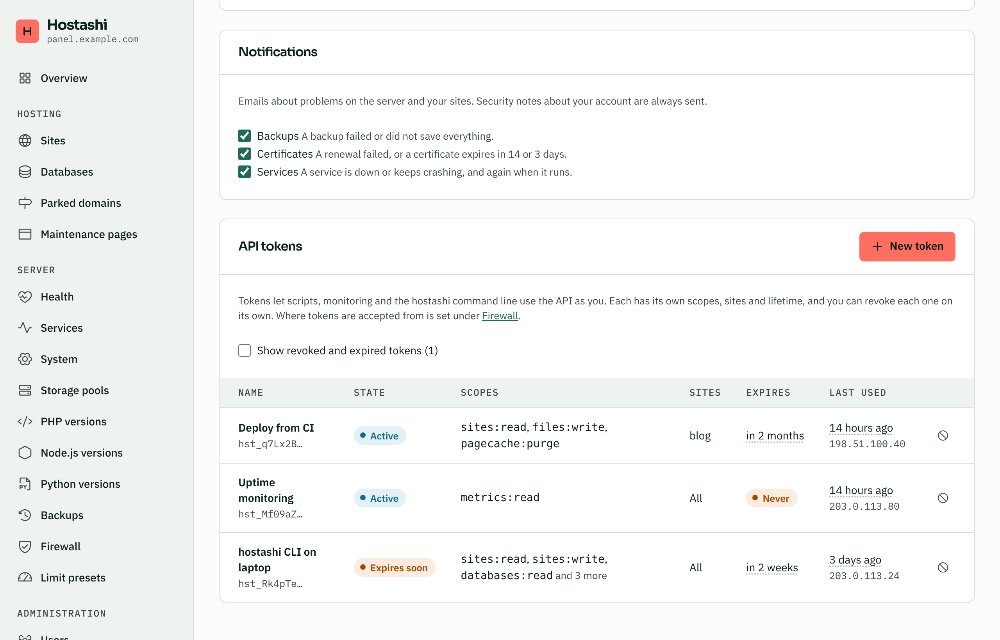
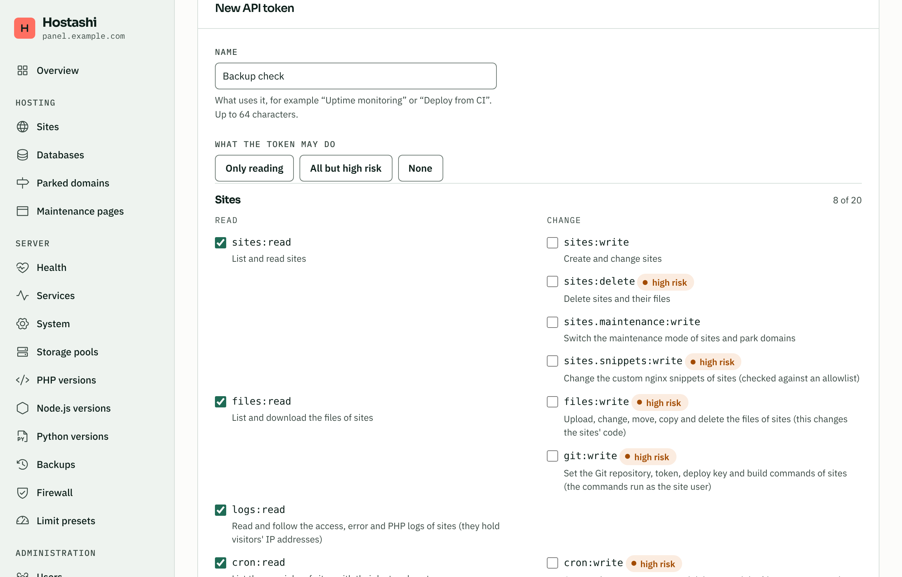
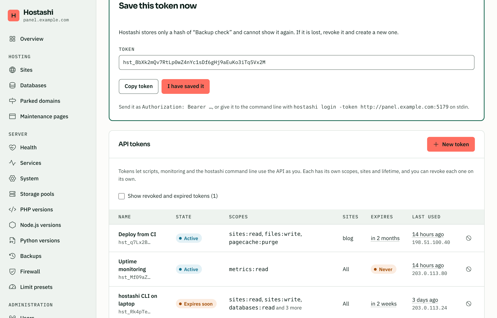
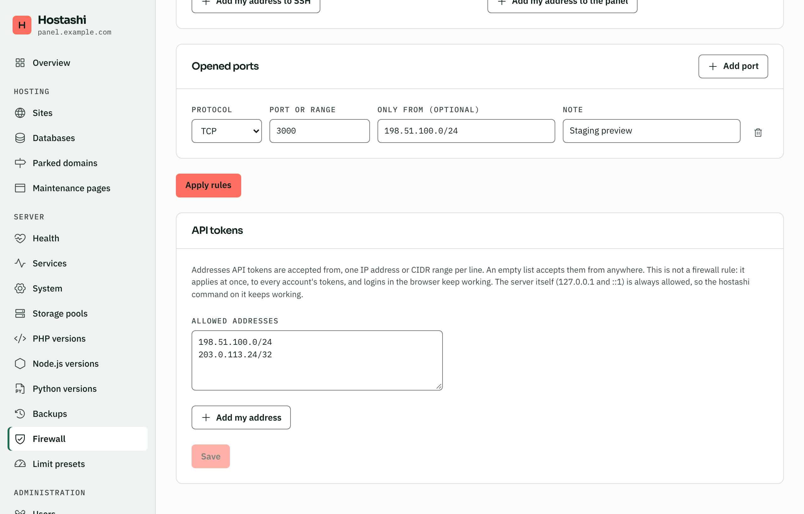

# API tokens

**For:** everyone with a panel account.

An API token lets a script, a monitoring system, a deploy job or the `hostashi` command line use the panel's API as you. You can have several tokens, one for each job, and each one has its own name, scopes, sites and lifetime. Revoke a token and only the job that used it stops working.

A token never gets more than your account: only the scopes your [role](Users-and-roles.md) can use and only the sites you can reach. If your account is disabled, its tokens stop working too.



## Create a token

1. Open **Your account** (your name at the bottom of the menu) and go to **API tokens**.
2. Click **New token** and give it a name that says what uses it, for example "Uptime monitoring".
3. Pick what the token may do. **Only reading** ticks the scopes that read, **All but high risk** everything except the scopes marked *high risk*, **None** clears the list. Pick high-risk scopes such as `files:write` or `cron:write` only if the job needs them.
4. Leave **Every site I can reach** on, or untick it and pick the sites.
5. Set how many days the token is valid, 1 to 365. **Never expires** is for a job you look after yourself; such a token works until you revoke it.
6. Click **Create token**.



The panel then shows the token once. Copy it into your password manager or the secret store of your CI system and click **I have saved it**. Hostashi keeps only a hash and cannot show it again; if it is lost, revoke it and create a new one.



Creating, listing and revoking tokens needs a login in the browser. A token cannot create other tokens.

## Use a token

Send it in the `Authorization` header:

```sh
curl -H "Authorization: Bearer $HOSTASHI_TOKEN" https://panel.example.com/api/v1/sites
```

For the command line, pass it on stdin, or set `HOSTASHI_URL` and `HOSTASHI_TOKEN` (see [Command line](Command-line.md)):

```sh
pass show hostashi/ci | hostashi login -token https://panel.example.com
```

`hostashi login` without `-token` creates a token for you through the browser, with the same choice of scopes, sites and lifetime. Those tokens are listed here as well, named after the computer.

## Revoke a token

Click the revoke button at the end of the row and confirm. Everything that uses the token gets `401` at once. Revoked and expired tokens stay in the list for reference; tick **Show revoked and expired tokens** to see them.

The list shows when and from which address each token was last used, so a token that nobody uses any more is easy to spot. A token that runs out within 30 days is marked **Expires soon**.

Every new token and every revocation is written to the [audit log](Audit-log.md), and you get an email about a new token if you have [an address set](Email-notifications.md).

There can be up to 100 working tokens per account.

## Limit where tokens are accepted from

Admins can allow tokens only from known addresses, for example the office, the VPN and the CI runners. Open **Firewall**, go to the card **API tokens** and enter one IP address or CIDR range per line. An empty list accepts tokens from anywhere.



The list applies to the tokens of every account, at once. It is not a firewall rule, so it works without the Hostashi firewall and has no rollback; logins in the browser are not affected, so a wrong list cannot lock you out of the panel. A token used from another address gets `403 ip_not_allowed`, and the attempt is written to the audit log.

The server itself, `127.0.0.1` and `::1`, is always allowed, so the `hostashi` command on it keeps working whatever the list says. A token is still needed from there, so a local user of the server (for example a site's SSH account) gets no more than with any other address.
