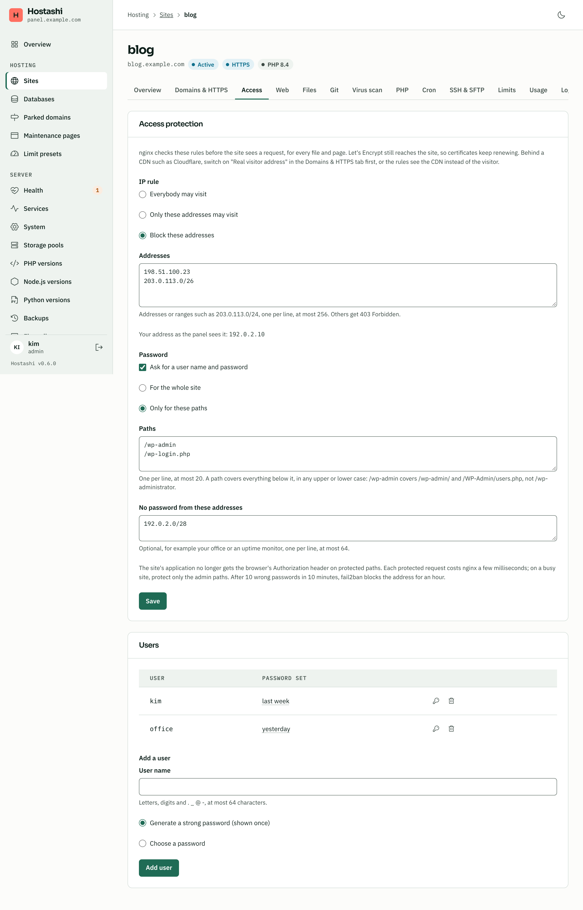
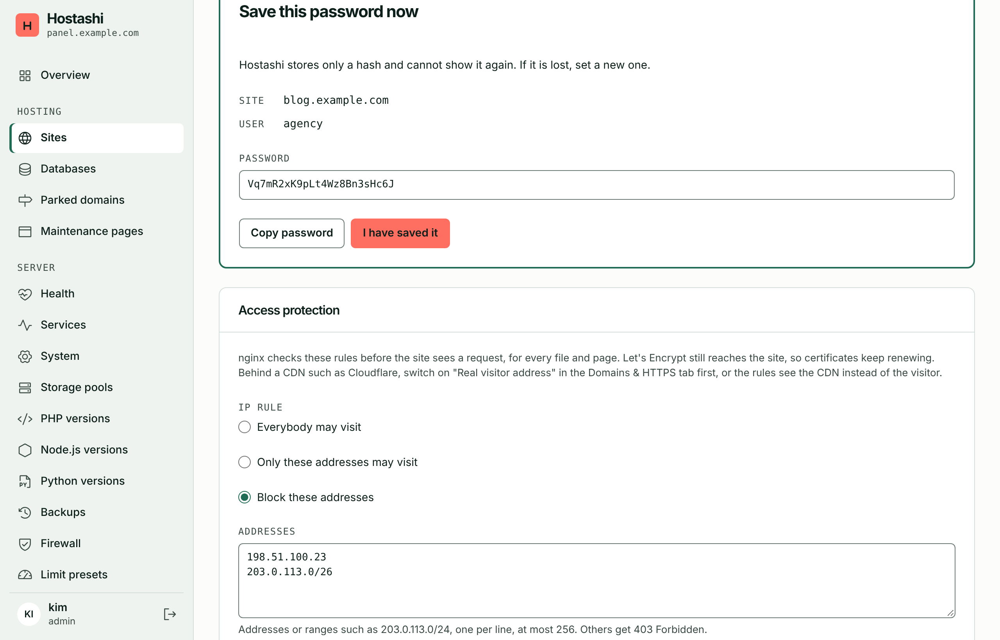

# Access protection

A site can let only some addresses in, block some addresses, or ask for a user name and password: for the whole site or only for some paths, such as the admin area of a CMS. nginx checks this before the site sees a request, for every file and page. You set it on the site's **Security › Access** tab.

**For:** everyone who can change the site.



## IP rule

1. Open the site and go to the **Security › Access** tab.
2. Under **IP rule**, choose:
   - **Everybody may visit**: no rule.
   - **Only these addresses may visit**: every other address gets *403 Forbidden*.
   - **Block these addresses**: these addresses get *403 Forbidden*.
3. Enter the addresses or ranges, such as `203.0.113.7` or `203.0.113.0/24`, one per line, at most 256.
4. Click **Save**.

The tab shows your own address as the panel sees it. When your address is not on an **Only these addresses** list, the tab warns you before you save.

## Password protection

1. Under **Users**, add at least one user first (see below).
2. Under **Password**, tick **Ask for a user name and password**.
3. Choose **For the whole site** or **Only for these paths**. Paths start with `/`, one per line, at most 20. A path covers everything below it, in any upper or lower case: `/wp-admin` covers `/wp-admin/` and `/WP-Admin/users.php`, but not `/wp-administrator`.
4. Optional: under **No password from these addresses**, list addresses that never need the password, for example your office or an uptime monitor. The addresses of the server itself are refused, because every site on the server could connect from them.
5. Click **Save**.

The browser shows its own dialog for the user name and password. After 10 wrong passwords in 10 minutes, fail2ban blocks the address for an hour, like after failed SSH logins.

The site's application no longer gets the browser's `Authorization` header on requests that need the password, so the password does not leak to the application. Where no password is asked, the header passes as before.

Each protected request costs nginx a few milliseconds to check the password. On a busy site, protect only the admin paths.

## Users



- **Add user:** enter a user name (letters, digits and `. _ @ -`, at most 64 characters). Choose **Generate a strong password** or **Choose a password** (12 to 72 characters). A generated password shows once: copy it before you leave the page.
- **New password** (key icon): sets a new password for the user, generated or your own.
- **Remove** (bin icon): asks once more, then removes the user. The last user stays while the password is on; switch the password off first.

A site has at most 50 users. The panel stores only a hash of each password; nobody can read a password back.

## What always stays open

Let's Encrypt still reaches `/.well-known/acme-challenge/`, so certificates keep renewing. The panel's health check of the site also stays open.

## Behind a CDN

Behind a CDN such as Cloudflare, every request comes from the CDN's addresses. Switch on [Real visitor address](Real-visitor-address.md) first, or the IP rule and the addresses without a password see the CDN instead of the visitor.

## Site types

Static, PHP, Node.js, Python, app and reverse proxy sites can use access protection. A redirect site has no **Security › Access** tab: nginx answers the redirect before it would check access. A site that becomes a redirect keeps its setting, but it takes effect only when the site becomes another type again.

## Custom nginx snippets

A custom snippet on the **Operations › nginx** tab must not use `allow`, `deny` or `satisfy` while an IP rule is on, nor `auth_basic`, `auth_basic_user_file` or `satisfy` while the password is on. The panel refuses saving such a snippet, and it refuses switching on the rule while a snippet uses these directives.

## Command line

```sh
hostashi api sites get-access blog
hostashi api sites add-access-user blog name=office
hostashi api sites set-access blog password:=true 'paths:=["/wp-admin"]'
hostashi api sites set-access blog ipMode=allow 'ips:=["203.0.113.0/24"]'
hostashi api sites set-access-user-password blog office
hostashi api sites delete-access-user blog office
```

`set-access` replaces the whole setting: fields you leave out are switched off. Without `password` a user name and password stops being asked. `add-access-user` and `set-access-user-password` without `password=` generate one and print it once.
