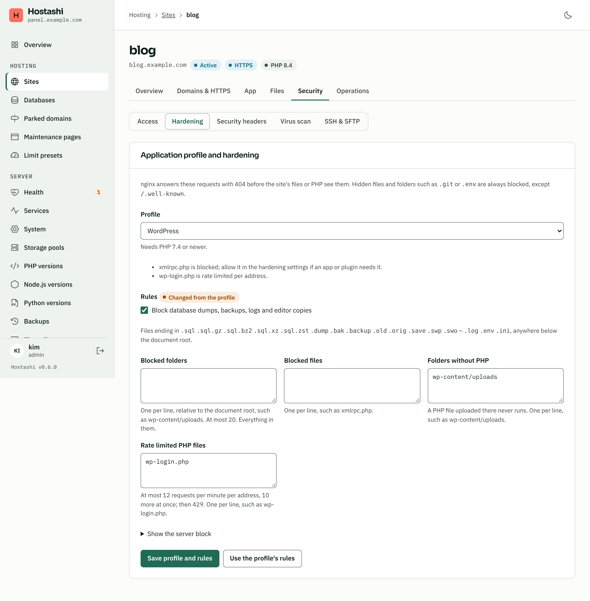
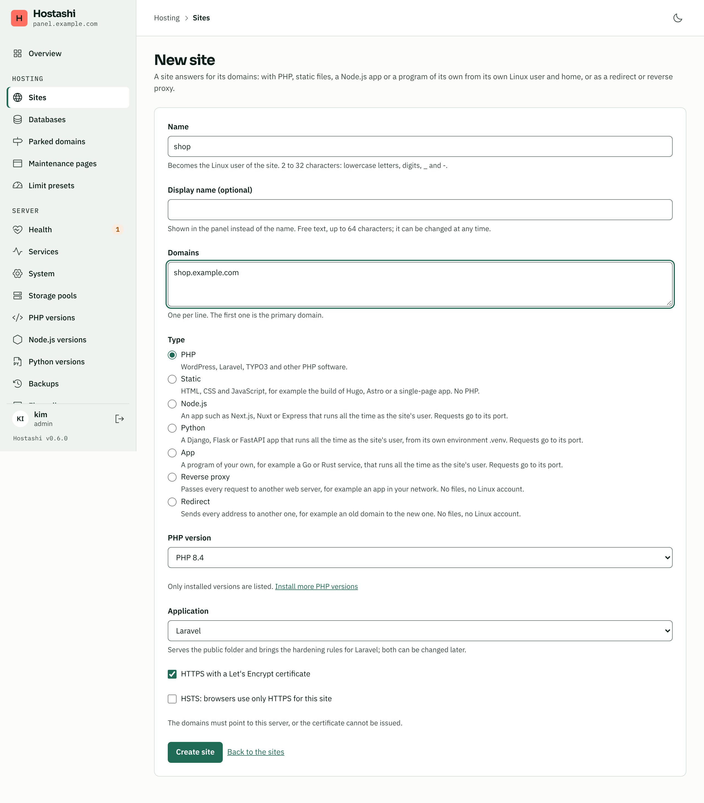
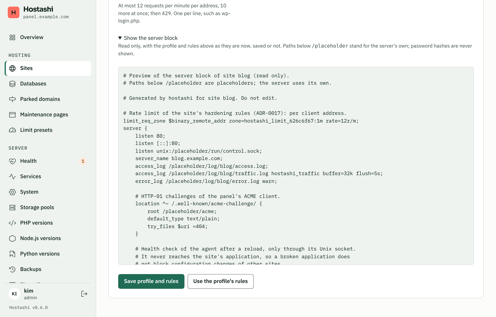
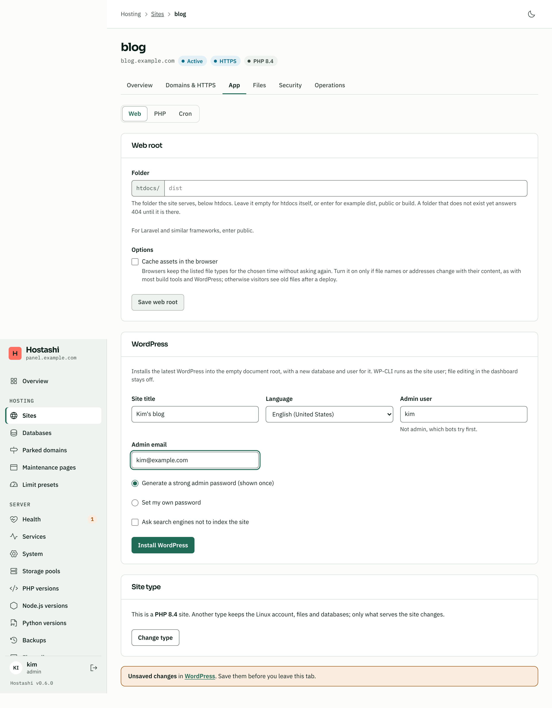
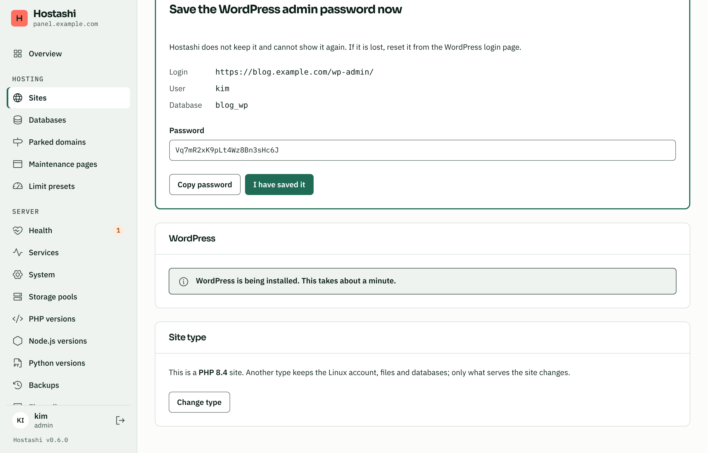

# Application profiles and hardening

An application profile tells the panel what runs on a static or PHP site, such as WordPress or Laravel. The profile brings hardening rules: nginx answers requests for files that should never be public with 404, before the site's files or PHP see them. You choose the profile when you create a site and can change it later on the site's **Security › Hardening** tab.

**For:** everyone who can change the site.

## The profiles

| Profile | Needs PHP | Serves | Rules besides blocked dumps and backups |
|---------|-----------|--------|-----------------------------------------|
| Static site | – | `htdocs` | none |
| Generic PHP | any | `htdocs` | none |
| WordPress | 7.4 | `htdocs` | no PHP in `wp-content/uploads`, `xmlrpc.php` blocked, `wp-login.php` rate limited |
| WooCommerce | 7.4 | `htdocs` | as WordPress |
| Laravel | 8.2 | `htdocs/public` | none |
| Symfony | 8.2 | `htdocs/public` | none |
| Shopware 6 | 8.2 | `htdocs/public` | none |
| TYPO3 | 8.2 | `htdocs/public` | no PHP in `fileadmin` and `typo3temp` |
| Drupal | 8.3 | `htdocs/web` | no PHP in `sites/default/files` |

The folder a profile serves only applies to new sites. Changing the profile of an existing site never touches its files or its web root.

## Choose a profile for a new site

On **Hosting → Sites → New site**, pick the **Application** of a PHP site below the PHP version. The panel refuses a PHP version older than the profile needs. Without a choice, a PHP site gets *Generic PHP*, and a static site always starts with *Static site*.

## Change the profile or its rules

1. Open the site and go to the **Security › Hardening** tab.
2. Choose a **Profile**. Its rules fill the form, and its notes appear below it.
3. Change the rules if the site needs it, for example clear `xmlrpc.php` from **Blocked files** when the WordPress app or Jetpack needs it.
4. Click **Save profile and rules**. nginx uses the new rules right away.

The panel stores only what differs from the profile. When a later Hostashi version changes a profile, a site keeps its own changes and gets the rest. The badge *Changed from the profile* shows that the site has changes; **Use the profile's rules** drops them.

### See the server block

**Show the server block** below the rules shows the nginx configuration the site gets with the chosen profile and the rules in the form, before you save them. It changes as you edit the form. The panel renders it with the same templates as the server, but it is read only and saves nothing. Paths below `/placeholder`, such as the web root, the PHP socket and the certificate, stand for the server's own paths. Password protection shows its rules but never the users or their password hashes. Custom snippets that point into the site's home are left out with a note. A site in maintenance or switched off is shown as it is served when it is back online. Everyone who can see the site can open it; the API route is `POST /api/v1/sites/{name}/profile/preview`.

## The rules

| Rule | What nginx does |
|------|-----------------|
| **Block database dumps, backups, logs and editor copies** | 404 for files ending in `.sql`, `.sql.gz`, `.sql.bz2`, `.sql.xz`, `.sql.zst`, `.dump`, `.bak`, `.backup`, `.old`, `.orig`, `.save`, `.swp`, `.swo`, `~`, `.log`, `.env` or `.ini`, anywhere below the web root |
| **Blocked folders** | 404 for everything in these folders |
| **Blocked files** | 404 for these files |
| **Folders without PHP** (PHP sites) | a `.php` file in these folders never runs, it gets 404; other files are served as before |
| **Rate limited PHP files** (PHP sites) | at most 12 requests per minute per address, 10 more at once, then 429 |

Paths are relative to the web root, one per line, at most 20 per list, for example `wp-content/uploads`. They may contain letters, digits, `.`, `_` and `-`, separated by `/`.

Hidden files and folders such as `.git`, `.env` or `.htaccess` are always blocked with 404, whatever the profile. `/.well-known` stays open, so Let's Encrypt and other checks keep working.

## Install WordPress

Any active PHP site can get WordPress in one step. The panel creates a database and its user, then WP-CLI downloads and installs WordPress as the site's user. The PHP site's own PHP version runs it.

1. Open the site and go to the **App › Web** tab.
2. Under **WordPress**, fill in the site title, the language, the admin user and the admin email. Do not call the admin user `admin`: bots try that name first.
3. Leave **Generate a strong admin password** on, or set your own of 12 to 128 characters.
4. Click **Install WordPress**.

The **web root must be empty**; WordPress installs only into an empty folder. The database is called `<site>_wp`, with `-` in the site name turned into `_`; if that name is taken, the panel uses `<site>_wp2` and so on. It counts for the site's databases like any other, see [Databases](Databases.md).

A generated password is shown **once**, together with the login address, the user and the database. Copy it before you click **I have saved it**; the panel does not keep it. A lost password can be reset from the WordPress login page.

The install takes about a minute. The card shows its progress and, at the end, the log of WP-CLI. A site whose profile was *Generic PHP* gets the WordPress profile. The installed WordPress has file editing in the dashboard switched off (`DISALLOW_FILE_EDIT`).

### When the install fails

The card shows the error and the log. The database stays. To try again, empty the web root in the [file manager](File-manager.md) or over [SSH](SSH-and-SFTP.md), then reload the page. Delete the database on the **Databases** tab if you no longer need it.
