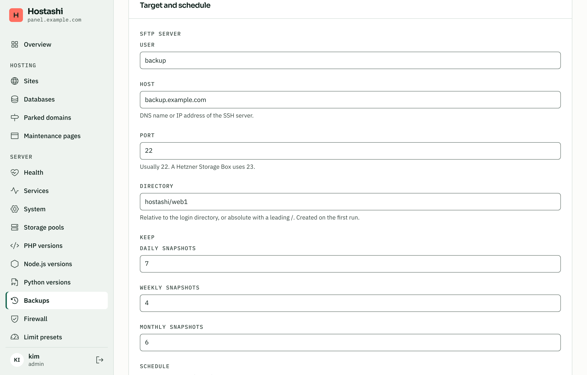
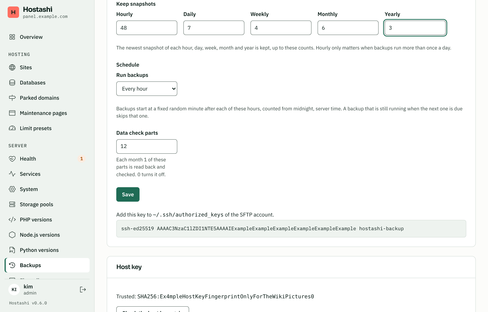
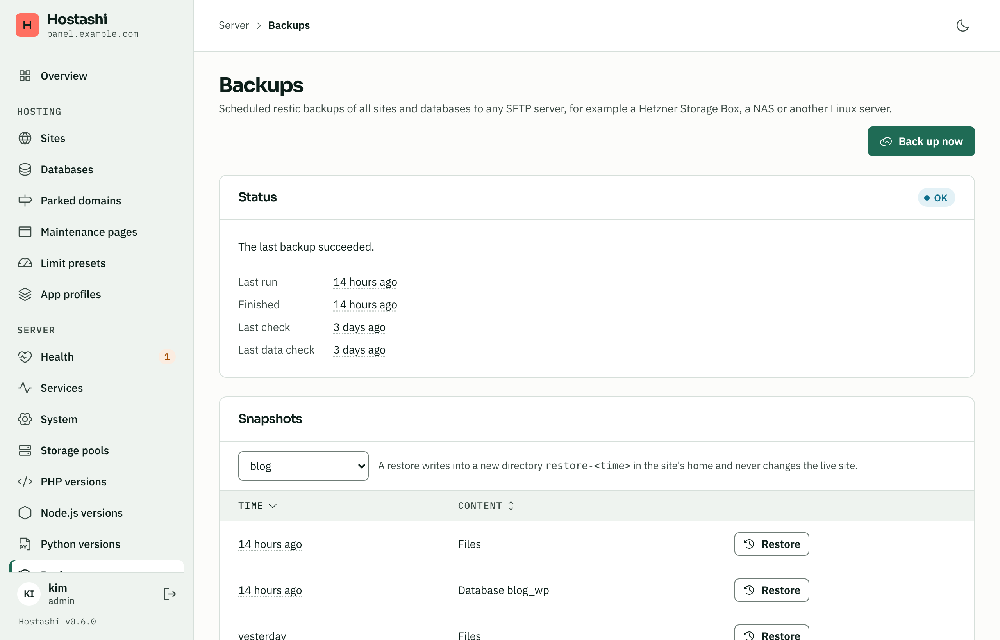
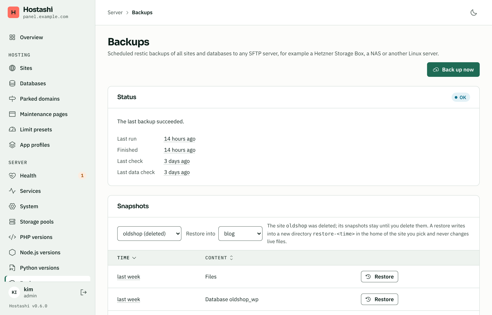

# Backups

**For:** panel admins.

Hostashi backs up every site's files and every database once a day with restic, encrypted, to an SFTP server. Restores never touch the live site.

Any SSH server that offers SFTP and accepts key login works: a Hetzner Storage Box, a NAS, or another Linux server. The account only needs write access to the backup directory; it does not need a shell.

## Set up the target

1. Create an account on the SFTP server for the backups. On a Hetzner Storage Box, turn on SSH access in its settings (a sub-account limited to one directory works well).
2. Open **Server → Backups → Target and schedule** and enter the user, the host (DNS name or IP address), the port and a directory. The port is usually 22; a Storage Box uses 23. The directory is relative to the login directory, or absolute when it starts with `/`. It is created on the first run.
3. The panel shows a **public key**. Add it to `~/.ssh/authorized_keys` of that account (on a Storage Box also possible in Hetzner's console).
4. Under **Host key**, fetch the server's SSH host key and compare the fingerprint with the server's own, for example `ssh-keygen -lf /etc/ssh/ssh_host_ed25519_key.pub` on that server, or the fingerprints your provider publishes. Backups start only after you confirm it.
   
5. Under **Run backups**, choose how often: once a day, or every 1, 2, 3, 4, 6, 8 or 12 hours. Once a day starts at a random time in the window between the two hours. Shorter intervals start at a fixed random minute after each of those hours, counted from midnight. All times are server time. A backup that is still running when the next one is due skips that one, so two backups never overlap.
6. Choose how many hourly, daily, weekly, monthly and yearly snapshots to keep. For each hour, day, week, month and year, the newest snapshot is kept, up to these counts. Hourly only matters when backups run more than once a day; hourly and yearly are 0 by default.
   

**Back up now** runs a backup right away; it runs in the background.

## Keep the keys outside the server

The backups are encrypted with a repository password. Restoring on a new server also needs the panel key. Print both once and store them in a password manager:

```sh
sudo hostashi backup key show
```

Without them, the backups are useless if the server is lost. They are never shown in the panel or the API.



## Data check

Once a month Hostashi reads part of the stored data back and checks it, a different part each month. **Data check parts** sets how much: each month 1 of that many parts is read; `0` turns it off. **Status** shows the last backup and the last data check.

## Restore files

1. Under **Snapshots**, choose the site.
2. Pick a snapshot and choose restore.
3. Hostashi writes it into a new folder `restore-<time>` in the site's home. Nothing in the live site changes.
4. Copy what you need from there into place, with [SFTP](SSH-and-SFTP.md) or the [file manager](File-manager.md), and delete the folder afterwards. It counts against the site's disk limit.

## Restore a database

Each database has its own snapshots in the same list. Restoring one writes its dump (`<database>.sql`, or `.dump` for PostgreSQL) into a `restore-<time>` folder of the site. The panel then offers **Import into a new database**: the dump goes into a new database, and the old one stays as it is. Check the new database, then point the site's configuration to it.

You can also import the dump into an existing database yourself, see [Databases](Databases.md).

On the command line, the same is `hostashi backup restore SITE SNAPSHOT`.

## Backups of deleted sites

Deleting a site does not delete its snapshots. Administrators find them under **Snapshots** in the site list, in the group **Deleted sites**.



1. Choose the deleted site.
2. Under **Restore into**, choose an existing site, for example a new site you created for it.
3. Restore a snapshot. Files go into a new folder `restore-<time>` in the home of that site; a database dump can then be imported into a new database of that site, as above.

If you create a new site with the name of a deleted one, the new site only shows the snapshots taken since it was created. The older ones are listed as **(earlier site)** under **Deleted sites** and can be restored into the site of the same name.

On the command line: `hostashi backup deleted` lists deleted sites with snapshots, `hostashi backup deleted SITE` their snapshots, and `hostashi backup restore-deleted SITE SNAPSHOT TARGET` restores one into the site `TARGET`.
