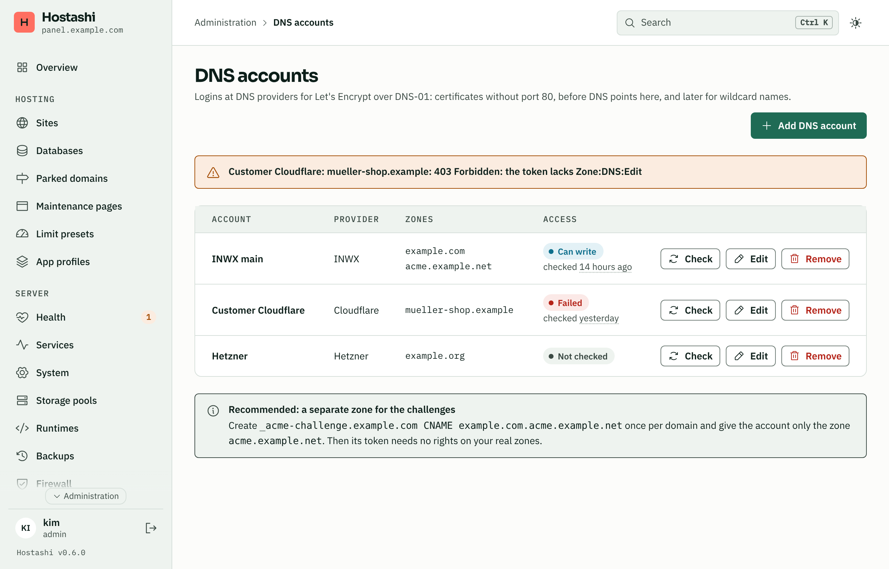
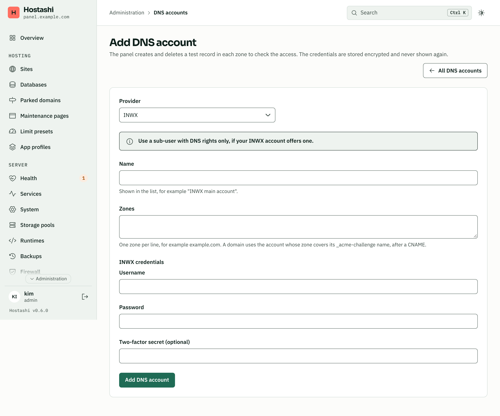
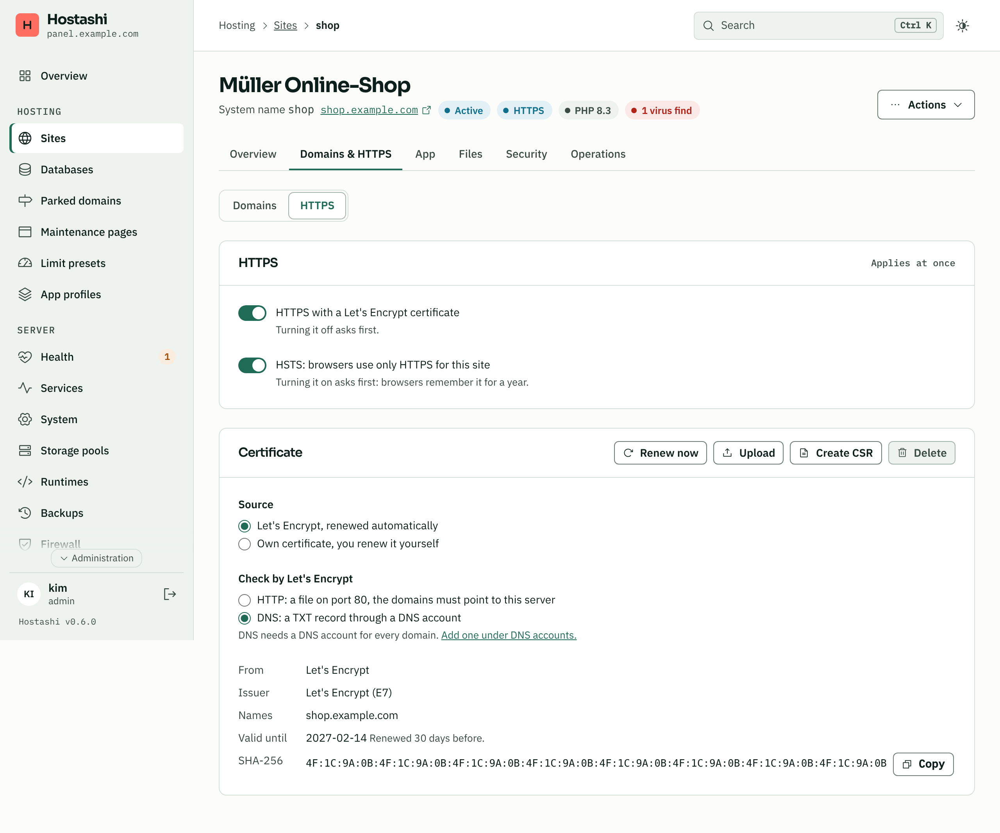

# DNS accounts

By default Let's Encrypt checks a domain over HTTP: it fetches a file from port 80 of the server the domain points to. With a DNS account, Hostashi can prove the domain over DNS instead (DNS-01): it writes a short-lived TXT record through the API of your DNS provider. That helps when

- port 80 is closed or the site sits behind a proxy that does not pass the check through,
- you want the certificate before the domain points to this server, for example when you move a site,
- and later for wildcard names such as `*.example.com`, which Let's Encrypt only issues over DNS.

Hostashi does not run DNS itself. It only creates and deletes `_acme-challenge` TXT records at your provider.

**For:** admins. Managers and users see which check a site uses but cannot switch it to DNS, because DNS can get certificates for names that do not point to this server.



## Providers

| Provider | What Hostashi needs |
|----------|---------------------|
| Cloudflare | An API token with **Zone: Read** and **DNS: Edit** on the needed zones only. Never the global API key. |
| Hetzner | A read/write API token of a Hetzner Cloud project. Use a separate project that holds only DNS zones: a token of a project with servers can delete them. Tokens of the old DNS Console do not work. |
| INWX | Username and password, and the shared secret if the account uses two-factor login. Use a sub-user with DNS rights only, if your account offers one. |

## Add an account

1. Go to **Administration › DNS accounts** and click **Add DNS account**.
2. Choose the provider, give the account a name and list its zones, one per line, for example `example.com`.
3. Enter the credentials and click **Add DNS account**.



Hostashi then checks the access: it creates and deletes a test record `_acme-challenge.<zone>` in each zone. The list shows **Can write**, or **Failed** with the provider's answer. A failed check does not stop you from saving; fix the token or the zones and click **Check**.

The credentials are stored encrypted and are never shown again, not even to admins. To change them, edit the account and tick **Replace the credentials**; otherwise they stay as they are.

Each zone belongs to one account. A zone may be a subdomain, for example `acme.example.net`.

## Which account a domain uses

For each domain, Hostashi looks at the name the TXT record must have: `_acme-challenge.<domain>`, or where a CNAME there points. The account whose zone covers that name, the longest one if several do, writes the record. A domain that no account covers cannot use DNS: the panel says which challenge name is missing.

## Recommended: a separate zone for the challenges

A token that can edit your real zones can also change your MX or A records. You can avoid that by delegating only the challenge records to a zone that exists for nothing else:

1. Create a zone, for example `acme.example.net`, at a provider Hostashi supports, and add a DNS account for only that zone.
2. Once per domain, add a CNAME at the domain's own DNS, wherever it is:

   ```
   _acme-challenge.example.com.  CNAME  example.com.acme.example.net.
   ```

3. Hostashi follows the CNAME and writes the TXT record into `acme.example.net`.

The domain's own DNS can then stay at any provider, also one Hostashi does not support, and the token has no rights on your real zones.

## Switch a site to DNS

On the site's **Domains & HTTPS › HTTPS** tab, under **Check by Let's Encrypt**, choose **DNS: a TXT record through a DNS account**. Hostashi refuses the switch if a domain of the site has no account. The current certificate stays; its renewals, **Renew now** and a new certificate after a domain change go over DNS from then on.



For the panel's own address, the same choice is on the [**System**](System-settings.md) page under **Panel certificate**.

A DNS certificate takes longer than one over HTTP, usually one to three minutes: Hostashi waits until the zone's name servers show the record before Let's Encrypt checks it.

## Remove an account

**Remove** asks first. Hostashi refuses to remove an account, or to take a zone away from it, while a site or the panel gets its certificate over DNS through it. Switch those to HTTP or give their zones to another account first.

## API

- `GET /api/v1/dns-providers` lists the providers and their fields.
- `GET` and `POST /api/v1/dns-accounts`, `GET`, `PUT` and `DELETE /api/v1/dns-accounts/{id}`, `POST /api/v1/dns-accounts/{id}/check`. Tokens need `dns_accounts:read` or `dns_accounts:write`; only admins can create such tokens.
- `PUT /api/v1/sites/{name}/tls/challenge` and `PUT /api/v1/panel/tls/challenge` with `{"challenge": "dns"}` or `{"challenge": "http"}`.

A domain without an account answers `422 no_dns_account`; removing an account in use answers `409 dns_account_in_use`. Every change goes into the [audit log](Audit-log.md); the credentials never do.

On the [command line](Command-line.md), for example:

```
hostashi api dns-accounts add label="INWX main" provider=inwx zones=example.com,acme.example.net 'credentials:={"username":"dns-user","password":"…"}'
hostashi api sites set-tls-challenge shop challenge=dns
```
