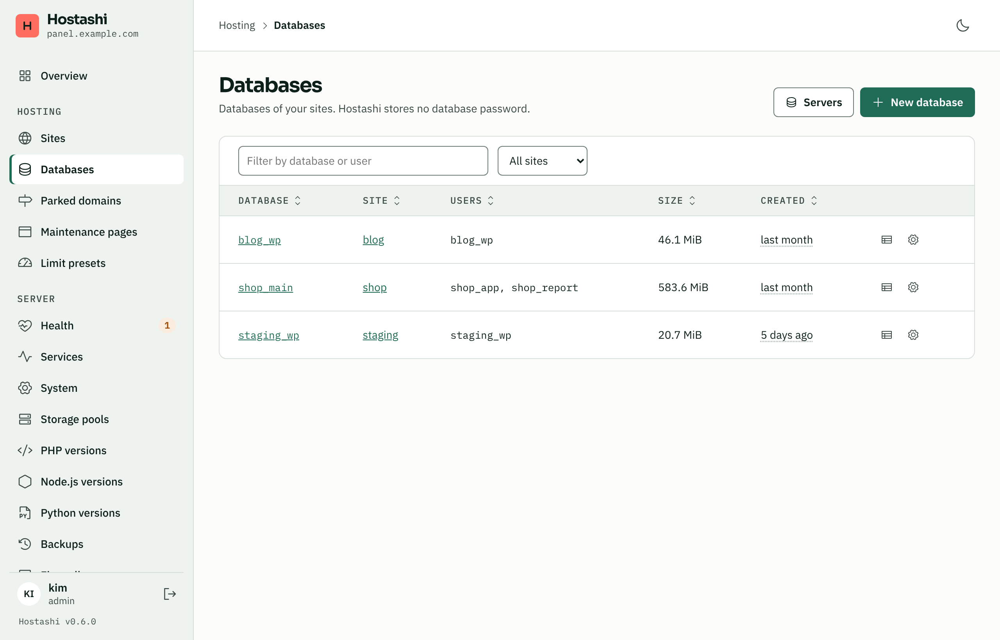

# Databases

**For:** everybody who can open a site, including users.

Every database belongs to one site. By default databases live in the server's own MariaDB; admins can add external servers (see below).

## Create a database

1. Open **Hosting → Databases → New database**.
2. Choose the **site**, the **database name** and the **user name** (lowercase letters, digits and `_`, starting with a letter).
3. If there are several database servers, choose one. A database stays on the server it is created on.
4. After creating, the panel shows the **password once**. Copy it into the site's configuration, for example `wp-config.php`.

Hostashi does not store database passwords and cannot show them again. If one is lost, set a new one on the database's page: the old password stops working at once, so update the site's configuration right after.

In the site's configuration, use `localhost` as the database host for the server's own MariaDB. For an external server, use the host name shown in the server list.

## Import and export

- **Import:** on the database's page, under **Import or export**, choose **Import a file**. MariaDB and MySQL take `.sql` or `.sql.gz`, PostgreSQL also `.dump` (`pg_dump` custom format).
  - **My computer:** pick the file. The panel uploads it into `hostashi-imports/` in the site's home, imports it and removes it again. While it is there it counts towards the site's disk space.
  - **The home of site …:** enter the path of a file already in the site's home, for example one uploaded with [SFTP](SSH-and-SFTP.md) or the [file manager](File-manager.md).
- **Export:** enter the file to write, relative to the home. An existing file is never replaced.

## Browse and edit the data

If the web database tool is installed, **Open in Adminer** opens the database in a new browser tab. Hostashi creates a temporary database user for it; that user and its connections end after the session length you choose. No password reaches your browser.

The top bar in Adminer shows when the session ends. **+30 min** opens the panel in a new tab, where one click extends the session; the Adminer tab shows the new time when you go back to it. **Logout** in Adminer opens the panel, where one click ends the session: the temporary user is removed and its connections close. The database's page in the panel lists the open sessions with the same two actions.

## Delete a database

On the database's page, **Delete database** removes it together with its users. This cannot be undone. Databases of a site are also deleted when the site is deleted.

## External database servers

**For:** admins. Under **Hosting → Databases → Database servers**, add a MariaDB, MySQL (8.0 or newer) or PostgreSQL server that the panel creates databases on:

- Give it a name for the panel, the host name or address, the port and an administrator account. For MariaDB and MySQL it needs `CREATE`, `DROP`, `CREATE USER` and `GRANT OPTION`; for PostgreSQL a role with `CREATEDB` and `CREATEROLE`, not a superuser.
- The panel stores that administrator password encrypted. It is the only database password Hostashi keeps.
- Use TLS with the server's CA certificate. Unencrypted connections work, but only inside a private network you trust.
- For PostgreSQL, allow only this server's address in its `pg_hba.conf`.

New databases go to the server marked as default. Removing a server from the panel changes nothing on the server itself.

See also [Database limits](Database-limits.md).
