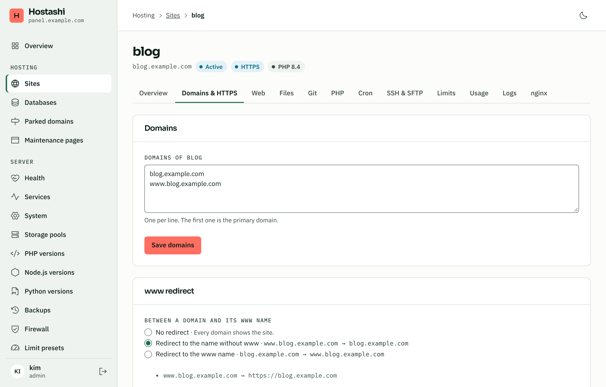
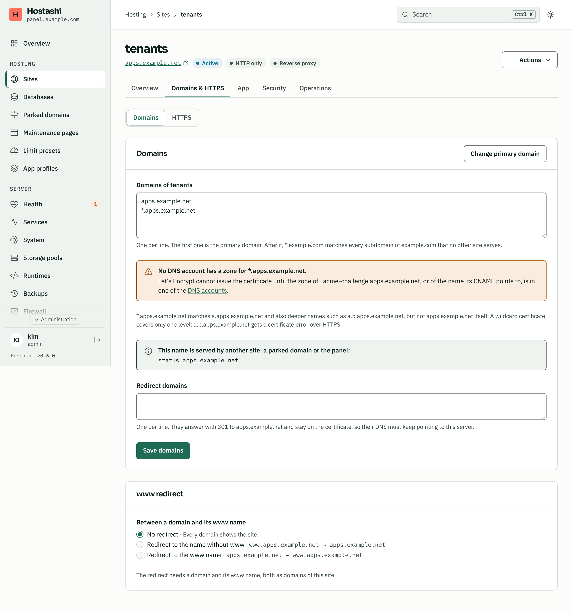
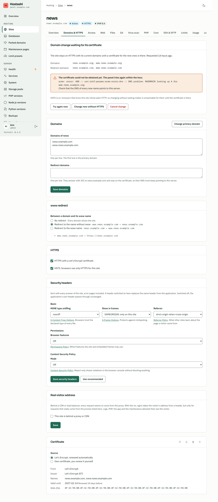
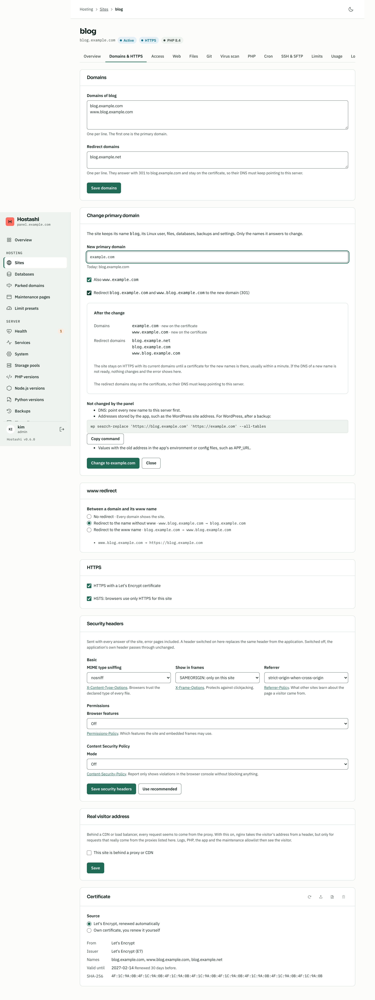
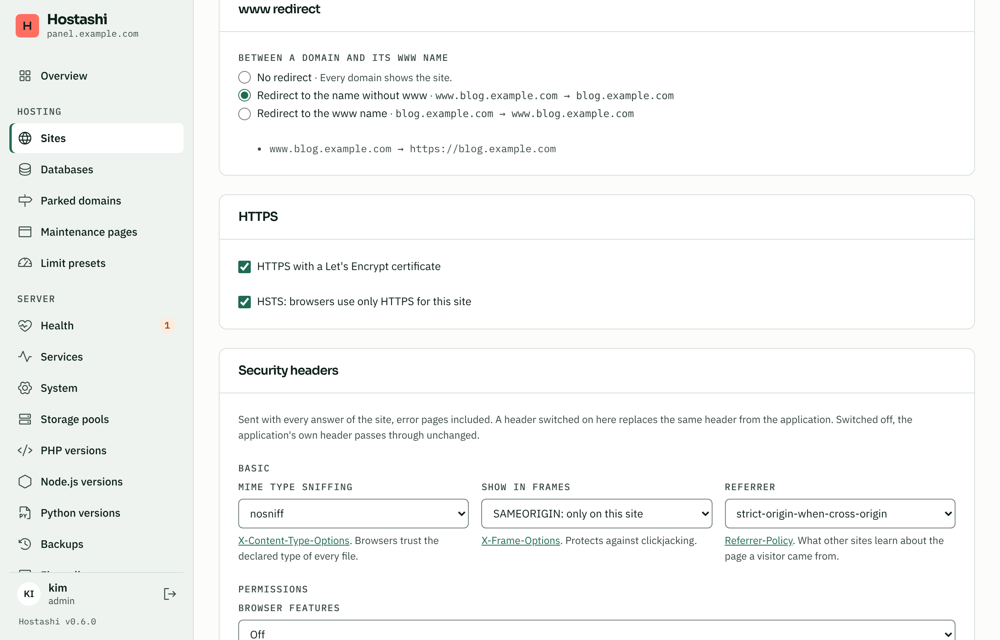

# Domains and HTTPS

**For:** panel admins and managers. Users cannot change domains or certificates, because a domain is a claim on a name that other customers might need.

## Point the domain to the server

Before you add a domain to a site, create DNS records at your DNS provider:

| Record | Name | Value |
|--------|------|-------|
| `A` | `example.com` and `www.example.com` | the server's IPv4 address |
| `AAAA` | the same names | the server's IPv6 address, if it has one |

Hostashi does not run DNS. Let's Encrypt checks each name over HTTP on port 80, so the records must resolve to this server and port 80 must be open. With a [DNS account](DNS-accounts.md), admins can switch a site to a check over DNS instead.

## Change the domains of a site

On the site's **Domains & HTTPS › Domains** tab, edit the list: one domain per line, the first one is the primary domain. The site keeps its name, Linux user, files, databases, backups and settings; only the names it answers to change.

**Redirect domains** answer every request with a permanent redirect (301) to the primary domain, path and query included. Use them for old names after a move, or for extra names that should not show the site themselves. They stay on the site's certificate, so their DNS records must keep pointing to this server; remove a name from the list once you no longer need it.

A domain can belong to one site or parked domain only, and never be the panel's own host name.

### Wildcard domains

[Reverse proxy and redirect sites](Site-types.md) can also answer for every subdomain: add `*.example.com` after the primary domain. A request for any name below `example.com` that no other site serves then reaches this site. Typical uses are an app that serves its customers under their own subdomain, or a redirect of every old subdomain to the main site.

- Names of other sites, [parked domains](Parked-domains.md) and the panel's address always win. With `*.example.com` on one site and `www.example.com` on another, `www.example.com` goes to its own site. The **Domains** tab lists such names.
- `*.example.com` does not cover `example.com` itself; list both if the site should answer for both.
- The wildcard also matches deeper names such as `a.b.example.com`, but a wildcard certificate covers only one level, so those get a certificate error over HTTPS.
- The wildcard cannot be the primary domain or a redirect domain, and other site types cannot have one. To change the type of such a site, remove the wildcard first.
- A redirect site may send `*.example.com` to `https://www.example.com` when another site serves `www.example.com`. A target the site would answer itself is refused, as it would loop.
- DNS: create a wildcard record such as `A *.example.com` that points to the server.

Let's Encrypt checks a wildcard only over DNS. Create the site without HTTPS, then either choose **DNS** as the check on the **HTTPS** tab (admins, with a [DNS account](DNS-accounts.md) for the zone) and turn HTTPS on, or upload an own wildcard certificate. Both tabs warn when no DNS account has a zone for the wildcard.

### When the change takes effect

- **Site on HTTPS with Let's Encrypt, new names:** the change waits until a certificate for all new names is there, usually less than a minute. Until then the site stays on HTTPS with its current domains. If a new name has no working DNS record yet, nothing changes: the tab shows the error, and the panel tries again within the hour. You can **Try again now**, **Change now without HTTPS** (the site is served over HTTP until the certificate is there; with HSTS on, browsers that know the site refuse that) or **Cancel change**. The new names are reserved for this site while the change waits.
- **Everything else** (site on HTTP, own certificate, or the certificate already names every domain): at once.

### Change the primary domain

**Change primary domain** does the common move in one step: enter the new domain, choose whether its `www` name is added too, and whether the old domain (and its `www` name) becomes a redirect domain. The form shows the domains after the change before you save.

The panel does not change what the site itself stores: addresses in the database (for WordPress run `wp search-replace 'https://old.example.com' 'https://example.com' --all-tables` over SSH, after a backup), values such as `APP_URL` in the app's environment or config files, and DNS. The form lists these with the command for your domains.

## Redirect to or from www

Most sites should answer under one name only, either `example.com` or `www.example.com`, and send visitors on the other name there. Choose this in the **www redirect** card on the same tab:

- **No redirect:** every domain shows the site. This is the default.
- **Redirect to the name without www:** `www.example.com` sends visitors to `example.com`.
- **Redirect to the www name:** `example.com` sends visitors to `www.example.com`.

The redirect is a permanent one (301) and keeps the path and query, so `www.example.com/shop?page=2` goes to `example.com/shop?page=2`. With HTTPS on, it goes straight to HTTPS in one step, and HSTS and the security headers are sent on the redirect too.

Both names must be domains of the site. If one is missing, the card offers a button such as **Add `www.example.com`**; it adds the name like the domain list above does, so create its DNS record first. With HTTPS on, the site is served over HTTP until the new certificate also names it. Hostashi never adds the other name on its own, because a name without a DNS record would stop the certificate for the whole site.

The setting works on every pair of a domain and its `www` name, so a site with `example.com`, `www.example.com`, `example.de` and `www.example.de` redirects both pairs. Other domains of the site, such as `shop.example.com`, are not touched. Redirect sites do not have this card: they send every name to their target anyway.

## HTTPS

The switches and the certificate are on the **Domains & HTTPS › HTTPS** tab. With **HTTPS with a Let's Encrypt certificate** on, Hostashi gets a certificate for all domains of the site, renews it on its own and redirects HTTP to HTTPS. Sites are served with HTTP/2 and HTTP/3.

If the certificate cannot be issued, the site page says why, for example a domain that does not point to the server. Hostashi tries again within an hour. Fix the DNS record and wait, or use **Renew now** on the certificate card.

### HSTS

**HSTS: browsers use only HTTPS for this site** tells browsers to never use plain HTTP for the domain again. Turn it on only once HTTPS works: browsers remember it for a year, even if you turn it off later.

### Own certificate

If you get certificates from another CA, use the certificate card on the same tab:

- **Upload certificate:** paste or upload the certificate, the chain (optional) and the private key (PEM, no passphrase; RSA with at least 2048 bits, or ECDSA P-256 or P-384). The key passes through your browser and the panel.
- **Create CSR:** Hostashi creates the key on the server and shows a certificate signing request. Give it to your CA and upload the certificate you get back. The key never leaves the server.

Hostashi checks that the key matches, the chain is complete, the certificate is valid and covers every domain of the site before it goes live. Own certificates are **not** renewed automatically: the panel warns 30 and 7 days before they expire.
