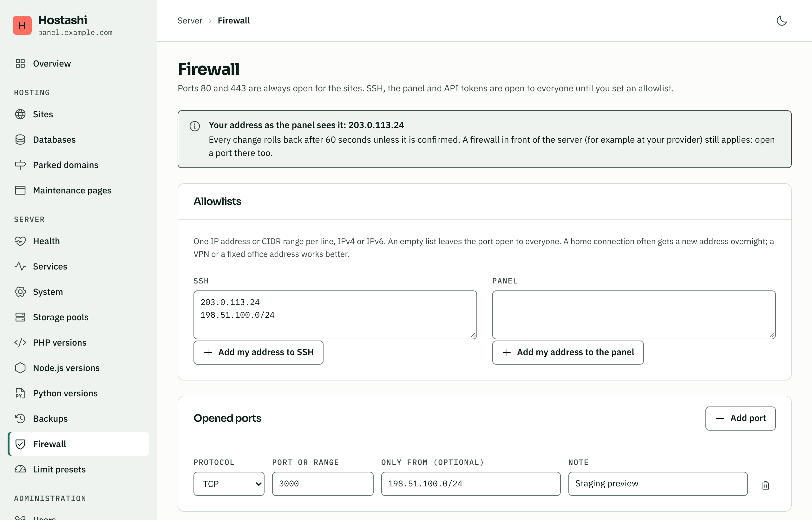
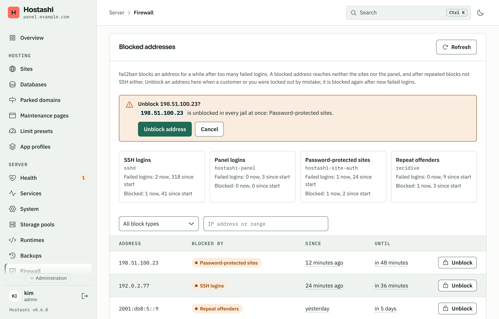

# Firewall

**For:** panel admins.

Hostashi runs its own firewall (nftables). It lets in SSH, the websites and the panel, and drops everything else. Outgoing traffic is not limited. If your provider has a firewall in front of the server as well, that one still applies: open a port there too.

Open **Server → Firewall**.

## What is always open

Ports 80 and 443 (TCP, and UDP for HTTP/3) are always open for the sites and cannot be closed in the panel. SSH (22) and the panel port (8443) are open to everyone until you set an allowlist.

## Allowlists for SSH and the panel

Under **Allowlists**, enter the addresses or networks (for example `203.0.113.7` or `198.51.100.0/24`) that may reach SSH or the panel. Everyone else is dropped. The page shows **your address as the panel sees it**, so you do not lock yourself out.

If the panel runs on port 443 under its own host name, its allowlist is checked by nginx instead (see [Install](Install.md#panel-without-a-port)).

Where API tokens are accepted from is set on the same page, in its own card; see [API tokens](API-tokens.md#limit-where-tokens-are-accepted-from).

## Open more ports

Under **Opened ports**, add a port or a range (`3000` or `6000-6010`), the protocol and, optionally, the addresses it is open to.

## Every change rolls back unless you confirm it

A wrong rule could cut you off, so each change is tested first:

- **Panel access changed:** your browser checks that the panel still answers and confirms on its own.
- **SSH allowlist changed:** the panel asks you to open a **new** terminal and log in over SSH. Keep the session you have open until that works, then choose **SSH works, keep the rules**.

Without a confirmation the rules roll back after the time shown on the page. The page then says that the last change was rolled back.

## Blocked after failed logins

Independent of these rules, fail2ban blocks addresses for a while after repeated failed SSH or panel logins, and after repeated wrong passwords on a site with [access protection](Access-protection.md). An address that is blocked again and again is blocked from everything, SSH included, for a week.

For IPv6, fail2ban blocks the whole /64 network of the address, because one connection usually has a /64 of its own and an attacker can pick a new address in it for every attempt. When the /64 also holds an address of this server (a network shared with other customers), only the single address is blocked. Unblocking an address lifts the block of its /64.

The card **Blocked addresses** on the same page shows each blocked address, why it was blocked, since when and until when, and how many failed logins each kind of protection has counted. When a customer or you were locked out by mistake, choose **Unblock** next to the address and confirm. The address is unblocked everywhere at once; new failed logins block it again. Every unblock is in the audit log.

On the command line, `hostashi firewall bans` lists the blocked addresses and `hostashi firewall unban ADDRESS` unblocks one. If fail2ban does not run, the card says so and **Health** shows a warning.

## Without the Hostashi firewall

A server installed with `--no-firewall` has no Hostashi firewall; the page says so. Use this only behind a provider firewall. To add more ports at install time instead, use `--firewall-allow PORT/PROTO`.
