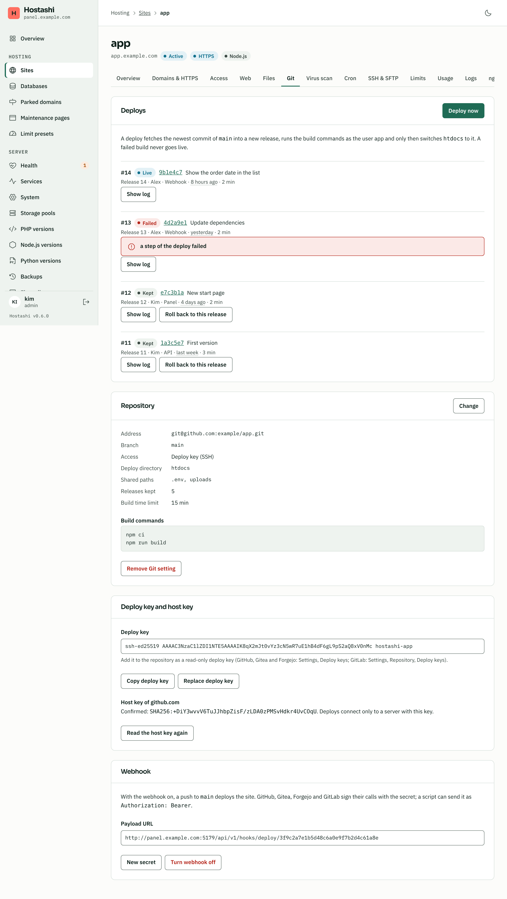
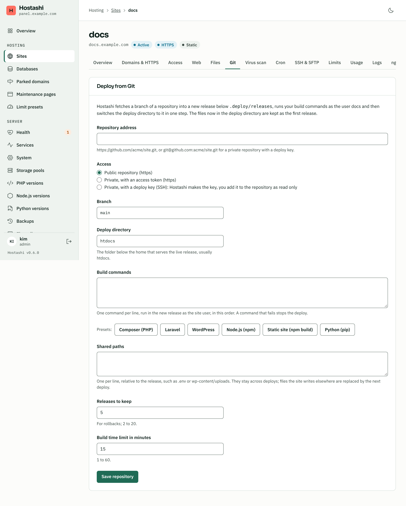
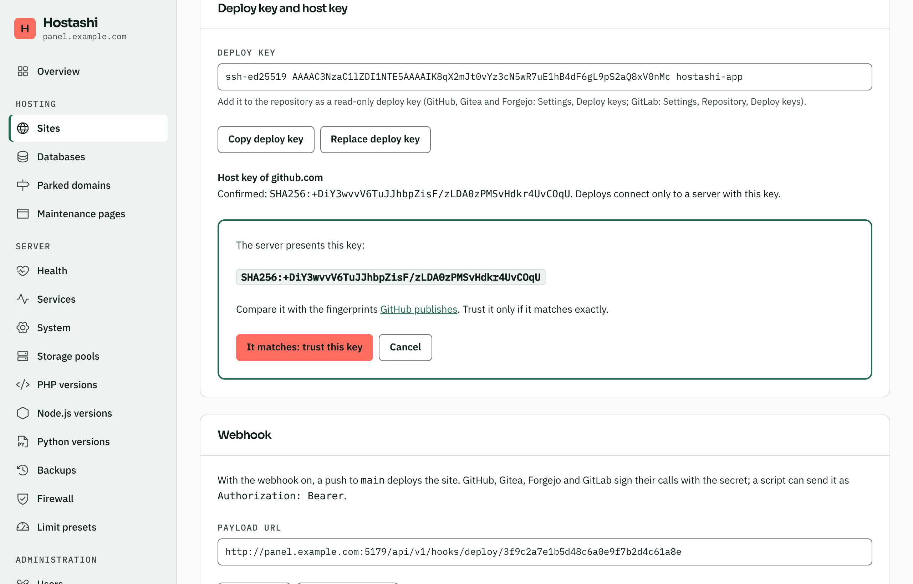
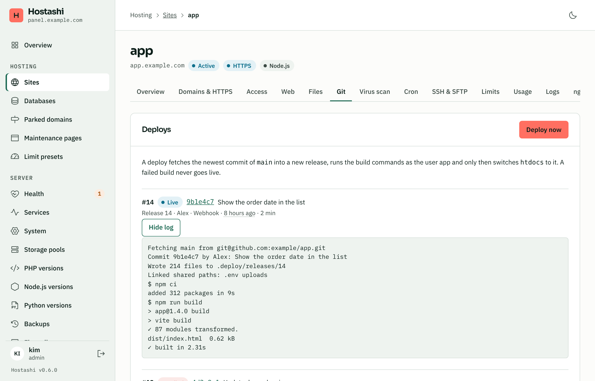
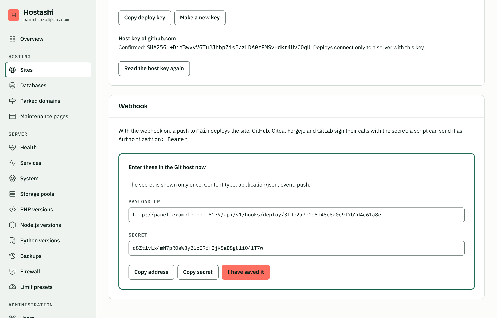

# Git deploy

A site can take its files from a Git repository. Each deploy fetches the branch, builds it in a new release folder and switches the site to it in one step, so visitors never see a half-updated site and a failed build never goes live. Older releases stay for a rollback.

**For:** admins and managers of a site set up the repository; everybody who can open the site, users too, can deploy and roll back.

The **Git** tab is there for static, PHP, Node.js, app and Python sites. Proxy and redirect sites have no files of their own, so they have no Git tab.



## Set up a repository

Open the site's **Git** tab and fill in the form.



| Field | Meaning |
|-------|---------|
| **Repository address** | `https://…` for a public repository or one with a token, `git@host:owner/repo.git` or `ssh://…` for a deploy key. `http://`, `git://` and local paths are refused. |
| **Access** | a public repository, a private one with an access token (HTTPS), or a private one with a deploy key (SSH) |
| **Branch** | the branch to deploy, `main` by default |
| **Deploy directory** | the folder below the home that serves the live release, usually `htdocs` |
| **Build commands** | one command per line, run in the new release as the site's user, in this order (at most 20). A command that fails stops the deploy. |
| **Shared paths** | files and folders that stay the same across releases, for example `.env` or `wp-content/uploads` (at most 32) |
| **Releases to keep** | how many earlier successful releases stay for rollbacks, 2 to 20 |
| **Build time limit in minutes** | the build is stopped when it runs longer, 1 to 60 |

**Presets** fill in the build commands and shared paths for Composer, Laravel, WordPress, Node.js (npm), a static site built with npm, and Python (pip). Check and change them before you save.

The build runs as the site's Linux user, inside the site's limits, with the site's Node.js and Python first on the `PATH`. It can do what the site's user can do over SSH, nothing more.

> **Shared paths matter.** Each deploy starts from the files in the repository. Anything the site writes into its own folder while it runs, such as uploads or plugins that WordPress installs, is gone after the next deploy unless its path is shared. On the first deploy, a shared file from the repository (a default `.env`, say) becomes the starting point; later deploys keep the shared copy.

### Access token

For a private repository over HTTPS, create a read-only token at the Git host (GitHub: a fine-grained token with read access to the repository's contents; GitLab: a deploy token or a project access token with `read_repository`). GitLab needs the user name of the token too, for example `oauth2`. The token is stored encrypted and never shown again.

### Deploy key

With a deploy key, Hostashi makes a key for the site. Copy it with **Copy deploy key** and add it to the repository as a read-only deploy key:

- GitHub, Gitea and Forgejo: the repository's **Settings → Deploy keys**,
- GitLab: **Settings → Repository → Deploy keys**.

**Make a new key** replaces it; the old key stops working at once, so add the new one to the Git host right after.

### Confirm the host key

Before the first deploy over SSH, the panel has to know the Git server's host key, so nobody in between can pretend to be it. Click **Read the host key**: the panel connects to the server and shows the key's fingerprint.



Compare it with the fingerprint the Git host publishes. For GitHub, GitLab and Codeberg the panel links to their page; for your own Git server, ask its administrator or run `ssh-keygen -lf /etc/ssh/ssh_host_ed25519_key.pub` on it. Click **It matches: trust this key** only if it matches exactly.

The key stays when you change only the repository path. A new host name needs a new confirmation. If the server's key changes later, deploys fail until you confirm the new one.

## Deploy

Click **Deploy now**. The run appears at the top of the list and the list updates by itself while it runs. Only one deploy of a site runs at a time.

Each run shows the commit, its author and message, who started it (the panel, an API token or the webhook), when, how long it took and how it ended. **Live** marks the release the site serves now. **Show log** shows the output of the fetch and of every build command.



After a successful build the site switches to the new release. A running Node.js, app or Python site is then restarted, and an enabled page cache is emptied. A failed build, or a release that cannot go live, leaves the site on the release it had.

The first deploy of a site that already has files moves them into the release `0-initial`, so nothing is lost.

## Roll back

**Roll back to this release** on an earlier successful deploy switches the site back to its release, without building again. The rollback is a run of its own in the list. Only releases that are still kept can be a target.

## Deploy on every push (webhook)

With the webhook on, a push to the branch deploys the site. Click **Turn webhook on**: the panel shows the payload URL and a secret, once.



Enter them in the Git host right away:

| Git host | Where | What to enter |
|----------|-------|---------------|
| GitHub | repository **Settings → Webhooks → Add webhook** | Payload URL, content type `application/json`, the secret, event "Just the push event" |
| Gitea, Forgejo | repository **Settings → Webhooks → Add webhook → Gitea/Forgejo** | Target URL, content type `application/json`, the secret, trigger "Push events" |
| GitLab | project **Settings → Webhooks** | URL, the secret as **Secret token**, trigger "Push events" |
| A script | — | `curl -X POST -H "Authorization: Bearer <secret>" <payload URL>` |

A push to another branch, a tag or another event is ignored. A push while a deploy runs is not lost: one more deploy starts when it ends. Each webhook takes at most 10 calls a minute. Calls with a wrong secret are refused and count toward [fail2ban](Firewall.md).

**New secret** keeps the address and makes the old secret stop working; enter the new one in the Git host. **Turn webhook off** removes it; calls then fail.

The payload URL is on the panel's address, so the Git host must be able to reach the panel over HTTPS.

## Emails

Every user who can see the site can get an email when a deploy fails: switch on **Git deploys** under **Your account → Notifications**. It is off by default, admins included. See [Email notifications](Email-notifications.md).

## Remove the repository

**Remove Git setting** on the repository card deletes the setting, the token, the deploy key and the webhook. The live files stay where they are.

## API and command line

Everything on the tab is also in the API (`/api/v1/sites/{name}/git` and `/api/v1/sites/{name}/deploys`, see [API tokens](API-tokens.md)) and on the [command line](Command-line.md), for example:

```sh
hostashi api git start-site-deploy blog
hostashi api git list-site-deploys blog
```

An API token needs the scope `git:deploy` to deploy and `git:write` to change the setting.
