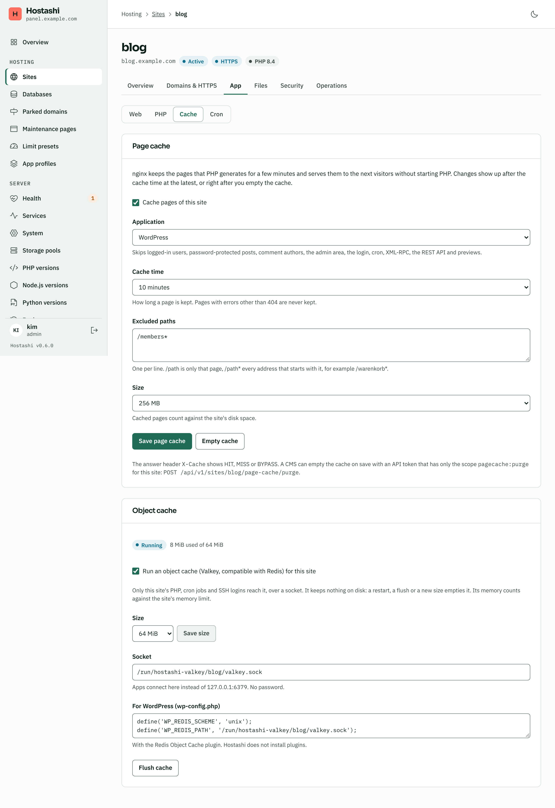

# Object cache

An object cache keeps the results of expensive work, such as database queries, in memory between requests. WordPress and many other PHP apps can use one through a plugin. Hostashi gives every site that wants one its own cache: a Valkey server (an open-source fork of Redis that speaks the same protocol) that runs as the site's own user.

The cache is off until you switch it on. It listens only on a socket that the site's own user can open, with no network port and no password. Other sites and other users on the server cannot reach it. It holds nothing worth keeping: a restart or **Flush cache** empties it, and it is not backed up.

## Switch it on

**For:** everyone who can change the site.

1. Open the site and go to the **App › Cache** tab.
2. Under **Object cache**, switch it on. It starts with 64 MiB.
3. Copy the connection details shown there into the app.



For WordPress with the *Redis Object Cache* plugin, add these lines to `wp-config.php` above `/* That's all, stop editing! */` (the panel shows them with the site's name filled in):

```php
define( 'WP_REDIS_SCHEME', 'unix' );
define( 'WP_REDIS_PATH', '/run/hostashi-valkey/<site>/valkey.sock' );
```

Then enable the cache in the plugin's settings. Hostashi does not install or change WordPress plugins.

Other apps connect to the Unix socket `/run/hostashi-valkey/<site>/valkey.sock` without a password, database 0.

## Size

**For:** admins and managers.

The size is 32 to 1024 MiB and at most half of the site's memory limit, so the cache cannot take the memory PHP needs. When the cache is full, it drops the entries used least recently. Change the size on the same card; the cache restarts and is empty afterwards.

The cache's memory counts against the site's memory limit, because it runs in the site's own resource group.

## Default in a limit preset

**For:** admins.

A limit preset can switch the object cache on for its sites: under **Limits**, edit the preset and choose a size under **Default for new sites**. A site gets the cache when it is created, imported or switched to the preset. If you change the size in the preset later, sites that follow the preset and have the cache on get the new size; the preset never switches a site's cache on or off afterwards. The size must be at most half of the preset's memory limit.

## Flush and switch off

**Flush cache** empties it at once, for example after a change the app does not notice. Switching the cache off stops it and removes its settings. While a site is disabled, its cache is stopped as well and starts again when the site is enabled.

## What the cache refuses

Commands that change the server itself (`CONFIG`, `SHUTDOWN`, `DEBUG`, `MODULE` and the like) are refused. Reading, writing, `FLUSHALL` and `INFO` work.

## Moving from CloudPanel

The import notices a WordPress site that used an object cache (a `wp-content/object-cache.php`) and switches the site's own cache on with the default size. On the old server the plugin connected to `127.0.0.1:6379`; that address is not there on Hostashi. After the import, change `wp-config.php` as shown above, otherwise the plugin reports that it cannot connect and the site runs without a cache.

## Health and metrics

The **Health** page checks that every switched-on cache runs and that its socket is private, and that the server-wide Valkey service of the distribution stays off. With metrics on, Prometheus gets `hostashi_site_object_cache_up`, `hostashi_site_object_cache_memory_bytes` and `hostashi_site_object_cache_max_bytes` per site.
