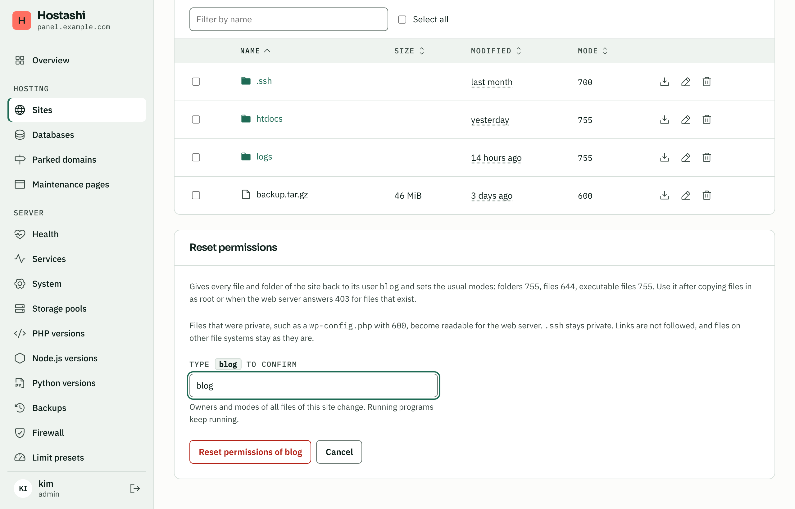
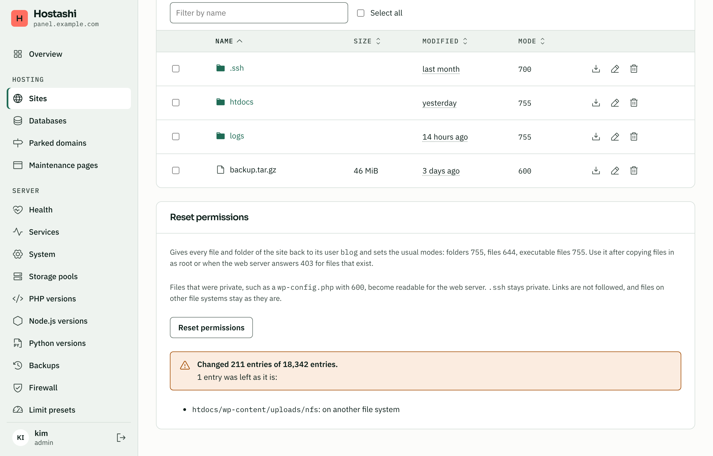

# Reset permissions

Files of a site belong to the site's own Linux user (the site's name). When files were copied in as root, unpacked from an archive or set to modes that are too open or too tight, the site can stop working: PHP cannot write its uploads, or nginx answers 403 for a file that exists. **Reset permissions** puts everything back in one step.

It is on the site's **Files** tab, below the file manager.



## What it does

| What | Owner | Mode |
|------|-------|------|
| the home folder (`/home/<site>`) | the site user, group `www-data` | `750` |
| every folder below it | the site user and its group | `755` |
| every file | the site user and its group | `644`, or `755` if it was executable before |
| folders and files in `.ssh` and `.gnupg` | the site user and its group | `700` and `600` |

setuid, setgid and the sticky bit are removed. Links get the site user as owner but are never followed, so a link cannot make the reset change anything outside the site. The link of a [Git deploy](Git-deploy.md) stays as it is.

Some entries are left as they are and listed after the reset:

- entries on another file system mounted inside the site, such as a network share
- device files
- files with several hard links that belong to someone else

Running programs keep running. A second reset only reads: it changes nothing that is right already.



## Before you reset

Files that a program made private become readable for the web server. A `wp-config.php` with `600`, for example, becomes `644`. Other sites still cannot read them, because the home folder is closed to them, and nginx never serves files whose name starts with a dot. If an application needs a file to stay private, set its mode again in the [file manager](File-manager.md) after the reset.

A very large site (hundreds of thousands of files) may not finish within 50 seconds. The panel then says so; run the reset again and it continues where it stopped.

Redirect and reverse proxy sites have no files and no reset.

## Who can use it

Everyone who can change a site: admins and managers for every site, users for the sites assigned to them. API tokens need the scope `sites:write`. Every reset is written to the [audit log](Audit-log.md) with the number of checked, changed and skipped entries.

From the command line:

```sh
hostashi api sites reset-permissions blog
```
