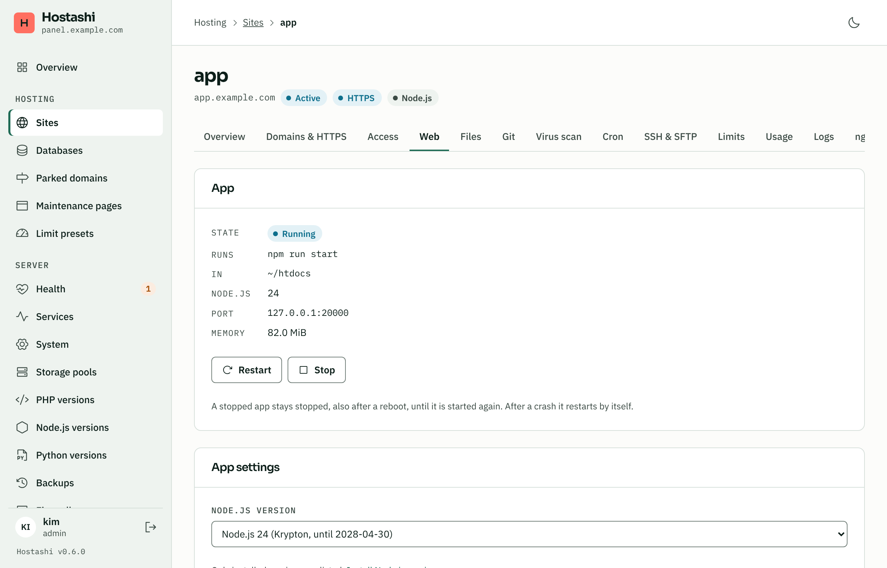
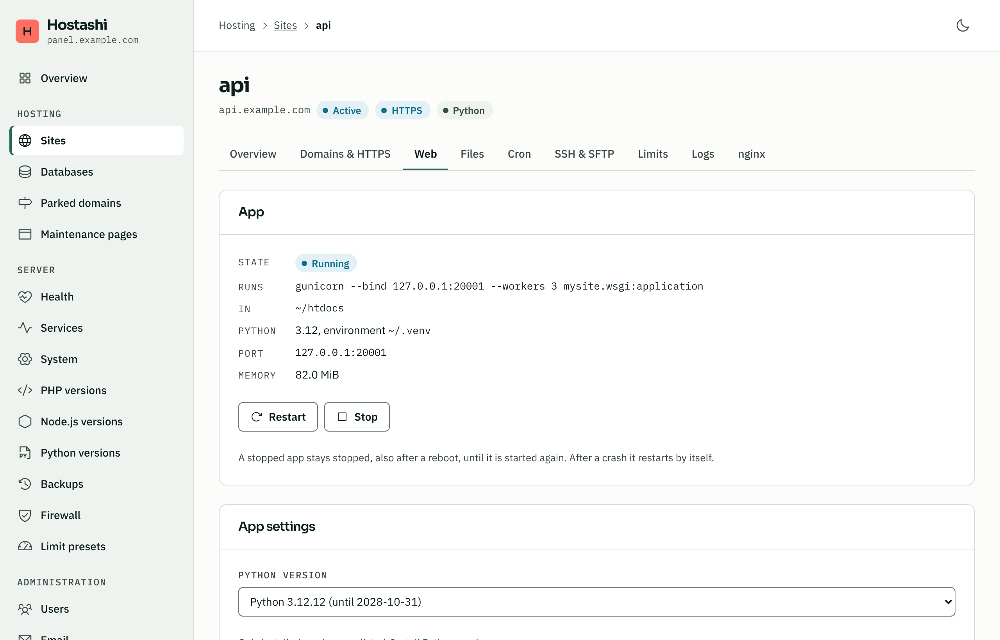
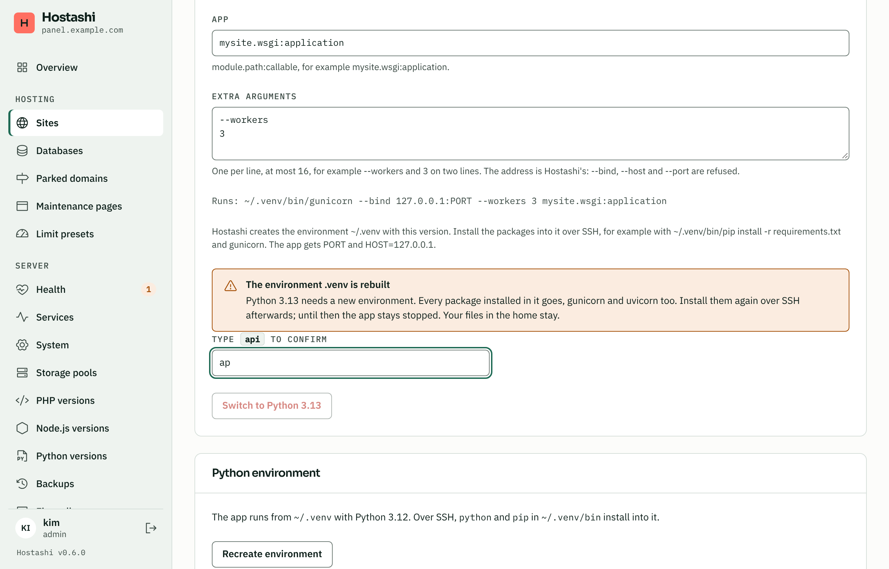
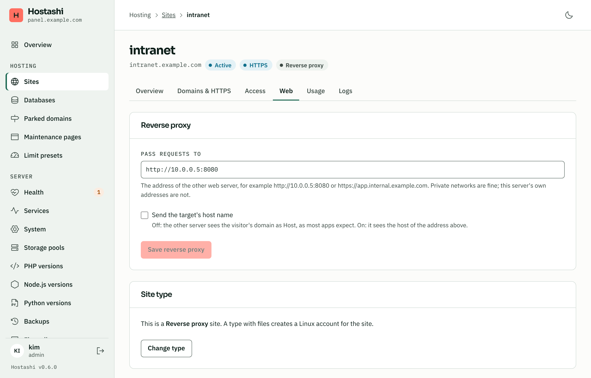
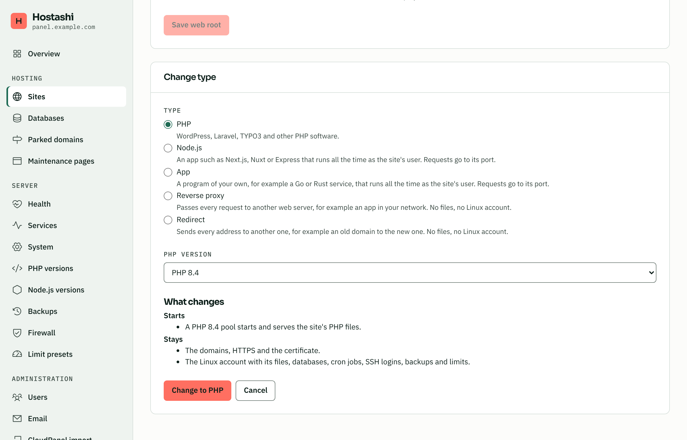

# Site types

**For:** panel admins and managers. Users see the type of their sites and can switch a site between static and PHP.

Every site has one type. It decides what serves the site's domains. Domains, HTTPS, security headers, the maintenance page and the site logs work the same for every type.

| Type | Serves | Linux user and files |
|------|--------|----------------------|
| **Static** | the files in the web root | yes |
| **PHP** | the files in the web root, PHP through the site's own PHP pool | yes |
| **Node.js** | a Node.js app that runs all the time | yes |
| **Python** | a Python app (Django, Flask, FastAPI) that runs all the time | yes |
| **App** | a program of your own, for example a Go or Rust service | yes |
| **Reverse proxy** | another web server, by passing every request on | no |
| **Redirect** | nothing: every address goes to another one | no |

You choose the type when you create a site ([Sites](Sites.md)) and can change it later on the site's **Web** tab.

## Static and PHP

The site serves the files in `/home/<name>/htdocs`, or in a folder below it that you set under **Web root**. For a single-page app, turn on **Single-page app**: addresses without a file then get `index.html`.

A PHP site runs its own PHP pool as the site's user. The version is chosen on the **PHP** tab; install versions under **Server → PHP versions**. See [PHP settings](PHP-settings.md).

## Node.js



A Node.js site runs one app as the site's user. nginx passes every request to it.

- **Node.js version.** Hostashi installs the official long-term support releases from nodejs.org under **Server → Node.js versions**. Install one there before you create the site. Updates of a version arrive with Hostashi updates; the apps of that version restart by themselves.
- **Working directory.** The folder the app starts in, below the home, `htdocs` by default. Usually the folder with `package.json`.
- **Start command.** Either a **start file** (`node server.js`) or an **npm script** (`npm run start`). Until one is set, the app stays stopped.
- **Port.** The panel gives each app its own port and passes it in the variable `PORT`, with `HOST=127.0.0.1` and `NODE_ENV=production`. Your app must listen on `PORT`. Only nginx and the site's own user can reach the port.
- **Environment variables.** Under **Environment variables** you set your own, one `NAME=value` per line, for example `DATABASE_URL`. The panel stores the values encrypted and shows only the names until you edit them. `PORT`, `HOST`, `HOME`, `USER`, `LOGNAME` and `PATH` are set by the panel; `NODE_ENV` you may change. A change restarts the app.

Upload the code with SFTP or the [file manager](File-manager.md), and install its packages in the site's SSH shell ([SSH and SFTP](SSH-and-SFTP.md)) with the site's Node.js version first in `PATH`, for example:

```sh
cd ~/htdocs
PATH=/opt/hostashi/node/24/bin:$PATH npm ci
```

Then choose **Restart**. **Stop** keeps the app stopped, also after a reboot, until you start it again. After a crash it restarts by itself. Its output is in the **app** log on the **Logs** tab ([Site logs](Site-logs.md)). The site's [limits](Limits.md) apply to the app.

## Python



A Python site runs one app as the site's user, from its own environment `~/.venv`. nginx passes every request to it. It works like a Node.js site, with these differences:

- **Python version.** Hostashi installs the supported lines of Python from the CPython builds of [python-build-standalone](https://github.com/astral-sh/python-build-standalone) under **Server → Python versions**, each download checked against a pinned checksum. Install one there before you create the site. A newer release or build of a line arrives with a Hostashi update; the environments stay and the apps restart by themselves. A line can be removed once no site uses it.
- **Start command.** **WSGI with gunicorn** (`mysite.wsgi:application`, Django, Flask), **ASGI with uvicorn** (`main:app`, FastAPI) or a **Python file** (`app.py`). Until one is set, the app stays stopped. Under **Extra arguments**, one per line, you add options such as `--workers` and `3`. The address is Hostashi's: for gunicorn and uvicorn, `--bind`, `--host` and `--port` are refused. A Python file listens on `HOST` and `PORT` itself.
- **Environment.** Hostashi creates `~/.venv` with the chosen version when the site is created. It does not install packages. Install them in the site's SSH shell, gunicorn or uvicorn included, for example:

  ```sh
  cd ~/htdocs
  ~/.venv/bin/pip install -r requirements.txt gunicorn
  ```

  Until gunicorn or uvicorn is installed there, the app stays stopped and the **App** card says it is waiting for its packages.
- **Port and environment variables** as for Node.js: the app gets `PORT` and `HOST=127.0.0.1`, plus `PYTHONUNBUFFERED=1`.



**Changing the Python version** of a site builds `~/.venv` again, because an environment belongs to one version. Every package in it is gone, and the app stays stopped until you install them again. The panel asks you to type the site's name first. Your files stay. **Python environment → Recreate environment** does the same with the same version, for example when `.venv` is broken or was deleted.

## App

An app site runs a program of your own instead of Node.js, for example a Go, Rust or Java service. It works like a Node.js site:

- **Program:** the executable below the site's home, for example `bin/server`. Upload it first; the app starts once it is there.
- **Arguments:** one per line. Each line reaches the program exactly as written; no shell reads it.
- **Working directory**, **port**, **environment variables**, start, stop, restart and the app log as for Node.js.

## Reverse proxy



A reverse proxy site passes every request to another web server, for example an app on another machine in your network. It has no Linux user, files, databases, cron jobs or SSH access.

- **Pass requests to:** `http://` or `https://`, a host or IP address, an optional port and path, for example `http://10.0.0.5:8080`. Private networks are fine. This server's own addresses, loopback (`127.0.0.1`) and link-local addresses are refused, so a site cannot reach the panel or other local services.
- **Send the target's host name:** off by default, so the other server sees the visitor's domain, as most apps expect.
- **Do not verify the target's certificate:** only for an `https` target with a self-signed certificate in a network you trust.

The other server gets the visitor's address in `X-Forwarded-For` and `X-Real-IP`. WebSockets work.

## Redirect

A redirect site sends every address to another one, for example an old domain to the new one. It has no Linux user and no files.

- **Redirect to:** the full address, for example `https://www.example.com`.
- **Status code:** 301 for a move that stays. Browsers remember 301 and 308; use 302 or 307 while you test.
- **Keep the path:** on, `/shop/cart?id=1` goes to the same path on the target; off, every address goes to the target as it is.

A redirect to one of the site's own domains is refused, as it would loop.

## Change the type



Admins and managers can change the type at any time: **Web → Change type**. The panel shows the fields of the new type and what starts, stops and stays. The domains and HTTPS always stay.

- Between static, PHP, Node.js, Python and app, the Linux user with its files, databases, cron jobs, SSH logins, backups and limits stays. Only what serves the site changes. Between Node.js, Python and app the port stays too. A change to Python makes `~/.venv`; a change away from it leaves the environment in the home.
- From a reverse proxy or redirect to a type with files, the site gets a Linux user and home, as a new site does.
- To a reverse proxy or redirect, the Linux user and its files **stay** and keep working (SSH, cron jobs, backups); nginx only serves the proxy or redirect. The site's **Overview** then shows **This site still has a Linux account and files**. **Remove account and files** deletes the user, its home, databases, cron jobs and SSH keys, after you type the site's name. Backups stay until they expire.

If a change fails, for example because the new app's Node.js or Python version is not installed, the site keeps its old type.

## From CloudPanel

The [CloudPanel import](CloudPanel-import.md) takes over Node.js, Python and reverse proxy sites as these types.
