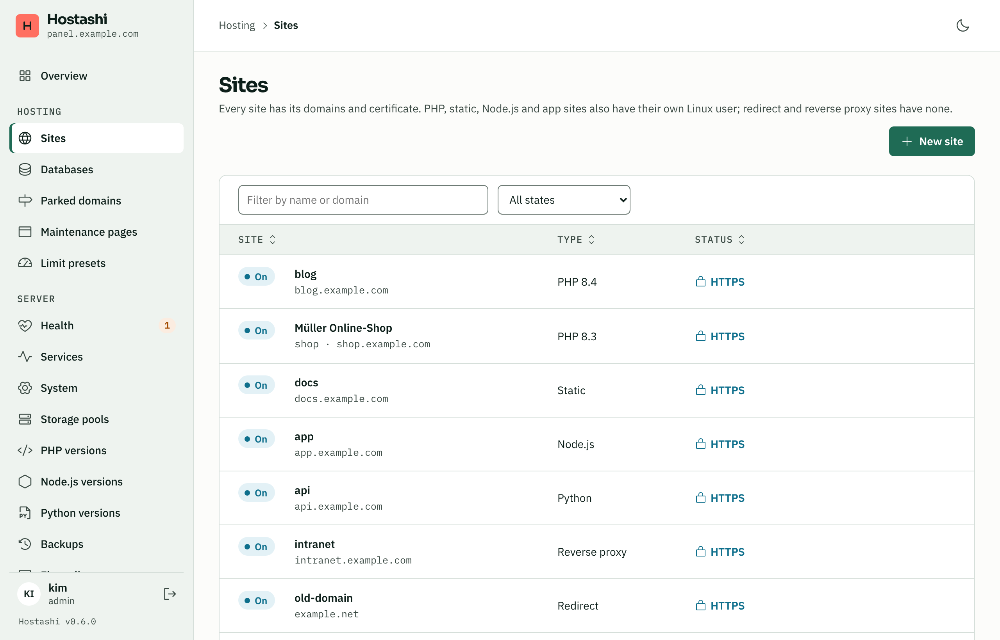
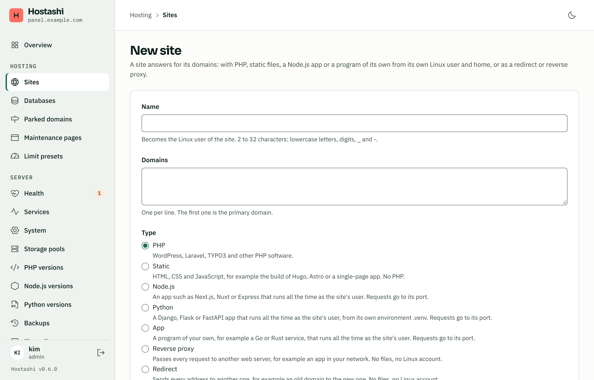
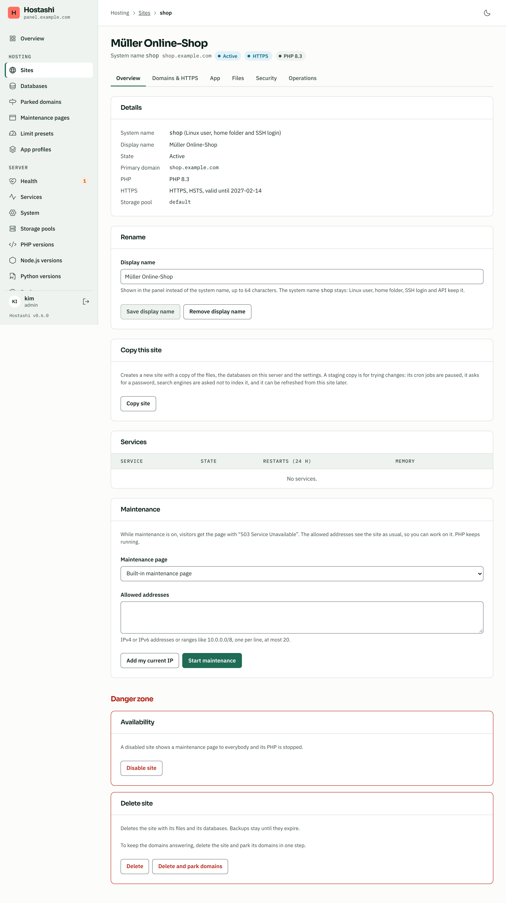

# Sites

**For:** panel admins and managers. Users see and change only the sites they were given.

A site is everything that answers for a set of domains: the web server configuration, the certificate and, for most types, its own Linux user with a home folder, its own PHP, Node.js or Python processes, cron jobs, SSH access and limits. Sites cannot read each other's files.

## Site types

| Type | For | Linux user and files |
|------|-----|----------------------|
| **PHP** | WordPress, Laravel, TYPO3 and other PHP software | yes |
| **Static** | HTML, CSS and JavaScript, for example the build of a static site generator or a single-page app | yes |
| **Node.js** | an app such as Next.js, Nuxt or Express that runs all the time; requests go to its port | yes |
| **Python** | a Django, Flask or FastAPI app that runs all the time, from its own environment; requests go to its port | yes |
| **App** | a program of your own, for example a Go or Rust service, that runs all the time; requests go to its port | yes |
| **Reverse proxy** | passing every request to another web server, for example an app in your network | no |
| **Redirect** | sending every address to another one, for example an old domain to the new one | no |

A site without a Linux user has no files, cron jobs, SSH access or limits. [Site types](Site-types.md) describes each type and how to change it later.

## Create a site

1. Open **Hosting → Sites** and choose **New site**.
2. **Name:** 2 to 32 characters, lowercase letters, digits, `_` and `-`. For sites with files the name is also the Linux user and the home folder, `/home/<name>`.
3. **Display name (optional):** free text up to 64 characters, shown in the panel instead of the name. It can be changed later, see [Rename a site](#rename-a-site).
4. **Domains:** one per line. The first one is the primary domain.
5. **Type:** see the table above. For PHP choose the version; only installed versions are listed (more under **Server → PHP versions**).
   For PHP also choose the **Application**, such as WordPress or Laravel. It brings the hardening rules, see [Application profiles](Application-profiles.md).
6. **HTTPS with a Let's Encrypt certificate:** leave it on. The domains must already point to this server, see [Domains and HTTPS](Domains-and-HTTPS.md).
7. If the server has more than one storage pool, choose where the site's home lives. A site stays on its pool.

Choose **Create site**. The panel opens the new site; it is live right away. Until the certificate is there, it answers over HTTP.

Upload your files with SFTP ([SSH and SFTP](SSH-and-SFTP.md)) or the [file manager](File-manager.md). For PHP and static sites, the web root is `/home/<name>/htdocs`; another folder can be set on the site's **App › Web** tab.

## The tabs of a site

| Tab | What you do there |
|-----|-------------------|
| Overview | state, display name, availability (enable, disable), delete |
| Domains & HTTPS | domains, certificate, HSTS, [security headers](Security-headers.md), [real visitor address](Real-visitor-address.md) |
| Access | [IP rules and password protection](Access-protection.md) |
| Web | web root folder, single-page app fallback, asset caching; the app, proxy or redirect settings; [changing the type](Site-types.md#change-the-type) |
| Files | the [file manager](File-manager.md) |
| Git | [deploys from a Git repository](Git-deploy.md), rollbacks and the webhook |
| PHP | PHP version and [settings](PHP-settings.md) |
| Cron | scheduled jobs |
| SSH & SFTP | keys for logging in as the site's user |
| Limits | CPU, memory, processes and disk |
| Logs | the site's [web server and PHP logs](Site-logs.md) |
| nginx | own nginx directives (admins only) |

Tabs that do not apply to a site's type are not shown.

## Rename a site

On **Overview → Rename**, set the **Display name** and choose **Save display name**. The panel then shows it in the site list and as the page title; **Remove display name** goes back to the name.

The name you chose when creating the site stays the site's system name: the Linux user, the home folder `/home/<name>`, the SSH and SFTP login, and the name in the [API and command line](Command-line.md). The site page always shows it next to the display name. Changing the display name changes nothing on the server and needs no restart.

The display name is plain text: up to 64 characters, no line breaks and no control characters.

## Disable a site

On **Overview → Availability**, **Disable** shows a maintenance page to every visitor and stops the site's PHP. Files, databases and settings stay. **Enable** brings it back.

### Your own maintenance and parking pages

Under **Maintenance pages** you can upload your own page: one `.html` file, or a `.zip` file with `index.html` at the top and its CSS, JavaScript, images and fonts. Write `%%DOMAIN%%` in the HTML where the visitor should see the domain they opened, for example `
%%DOMAIN%%
`. The web server puts in the visited domain in lower case, such as `www.example.com`; internationalized domains appear in their ASCII form (`xn--…`). The preview shows `example.com`. The placeholder is replaced in HTML files only, not in CSS or JavaScript.

## Delete a site

On **Overview → Delete site**. This deletes the site **with its files and databases** and cannot be undone. Backups stay until they expire.

To keep the domains answering, you can park them in the same step: choose the domains to park and a parking page. Domains you leave out are free afterwards. See [Parked domains](Parked-domains.md).
