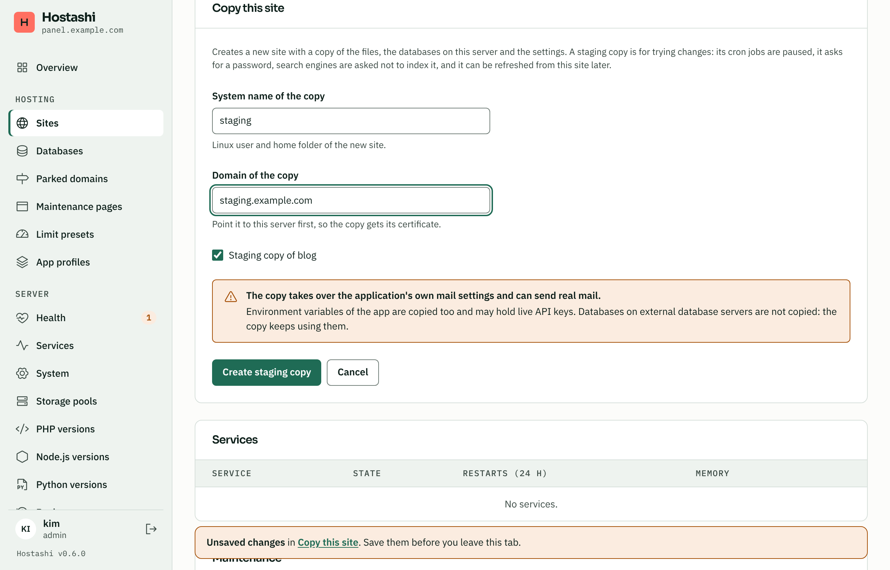
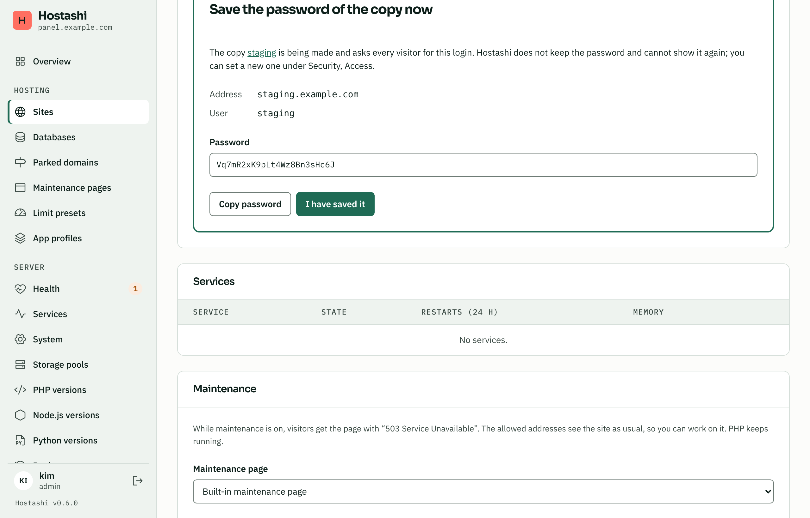
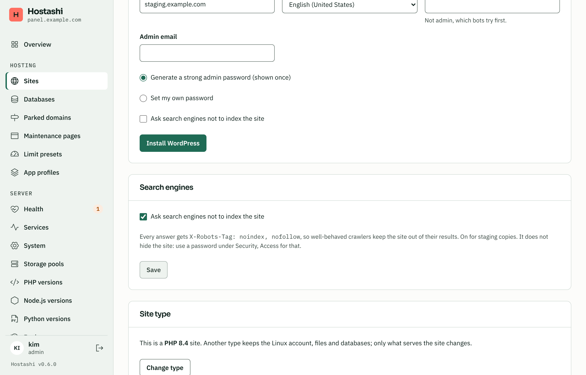
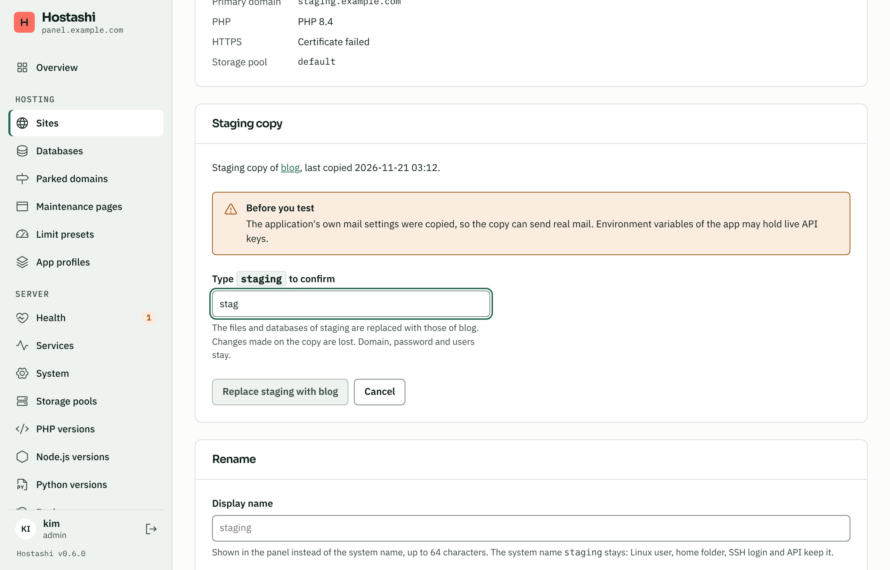

# Staging and copies

**Copy site** creates a new site from an existing one. You get a copy of its files, of its databases on this server and of its settings. A **staging copy** is meant for trying changes, such as a WordPress or plugin update, a new theme or another PHP version. You test on a separate domain with real content, and the live site stays as it is.

The card is on the site's **Overview** tab and only admins and managers see it.



## How it works

1. Point the copy's domain at the server first, for example `staging.shop.example.com`. The copy then gets its certificate right away.
2. Open the live site and click **Copy site**. Name and domain come filled in as `staging-<site>` and `staging.<first domain>`. Change them if you like, and choose another storage pool if there is one.
3. Leave **Staging copy** checked and click **Create staging copy**.
4. Save the login that is shown now. A staging copy asks every visitor for it. Hostashi shows the password only once; you can set a new one later under **Security › Access**.
5. The copy shows its progress on its own Overview tab: first the files, then the databases, then the configuration. When it is done, the copy is ready on its domain.
6. Test on the copy. When you are happy with the result, make the same change on the live site, for example by running the same update there.



There is no "copy to live". Copying the database back would overwrite everything the live site collected in the meantime, such as orders, comments and customer accounts.

## What is copied

| Copied | Not copied |
|--------|------------|
| all files of the home folder, except `.ssh` and the Git deploy cache | domains and certificates: the copy has its own |
| every database on this server, as a new database with its own user and password | databases on [external database servers](Databases.md): an application that uses one is not configured, and its copy stops with a message |
| site type, PHP version, PHP settings, web options and nginx snippets | the page cache: it starts empty |
| limits, security headers, visitor address, access rules (without the password users) | the object cache's content: the copy gets a new, empty one |
| the application profile and its hardening rules | Git deploy and its webhook |
| cron jobs: paused in a staging copy | SSH keys |
| the app's environment variables | |
| which accounts with the role user may manage the site | |

Before it starts, Hostashi checks that the storage pool has room for the files plus 10 % and the server has room for the databases plus 10 %.

### The application's configuration

The copy has to use its own database and its own domain, otherwise it would write into the live site's database:

- **WordPress**: Hostashi sets `DB_NAME`, `DB_USER` and `DB_PASSWORD` in `wp-config.php`. For a staging copy it also sets `WP_ENVIRONMENT_TYPE` to `staging`. Then it replaces every link to the live domains (with and without `www`, `http` and `https`) with the copy's domain in the database (`wp search-replace`) and flushes the cache. Plugins and themes are not loaded while it does this.
- **Laravel**: Hostashi sets `APP_URL`, and either `DB_URL` or `DB_DATABASE`, `DB_USERNAME` and `DB_PASSWORD` in `.env`. It also removes the cached configuration `bootstrap/cache/config.php`.
- **Symfony**: Hostashi changes user, password and database in `DATABASE_URL`, in `.env.local` when that file sets it, else in `.env`. A compiled `.env.local.php` stops the copy: delete it on the source or run `composer dump-env` again after the copy.
- **Other applications**: the copy's card lists what to change by hand: the database names, the site's own address and live services such as mail or payments.

The application profile decides which of these applies (see [Application profiles](Application-profiles.md)). If the configuration names a database that was not copied, the step fails rather than letting the copy use the live data.

## A staging copy

A staging copy is marked **Staging** in its page head. It differs from a plain copy in four ways:

- **Password**: the whole site asks for the generated login ([Access protection](Access-protection.md)).
- **Search engines**: every answer carries `X-Robots-Tag: noindex, nofollow`. The switch is on the **App › Web** tab, card **Search engines**.
- **Cron jobs**: paused, so nightly jobs do not send mail or import orders twice. Turn single jobs back on under [Cron jobs](Cron-jobs.md).
- **Refresh**: it can be refreshed from its source.



**Before you test:** the application's own mail settings are copied too. A shop on the copy can therefore send real order mails to real customers, and environment variables may hold live API keys, for example of a payment provider. Switch these to test settings first.

## Refresh from the source

On the staging copy, **Refresh from <source>** copies the live site's files and databases into the copy again. Domain, login, databases and users of the copy stay; everything changed on the copy is replaced. Type the copy's name to confirm.



While a copy or refresh runs, neither site can be copied or refreshed again.

## When something fails

The copy's card shows the reason. A first copy that fails is deleted again together with its new databases, and the reason stays in the [audit log](Audit-log.md) under `site.clone.failed`. A refresh that fails keeps the copy, marked as failed, and you can run it again.

## Who can use it

Admins and managers. API tokens need the scopes `sites:write` and `databases:write`. Every copy and refresh is written to the audit log.

From the command line:

```sh
hostashi api sites clone shop name=staging-shop domain=staging.shop.example.com staging=true
hostashi api sites get-clone staging-shop
hostashi api sites refresh-clone staging-shop
```
