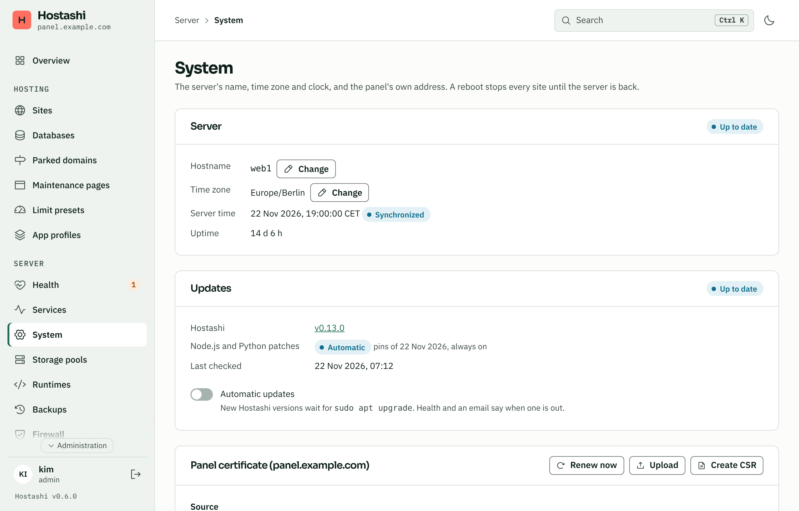
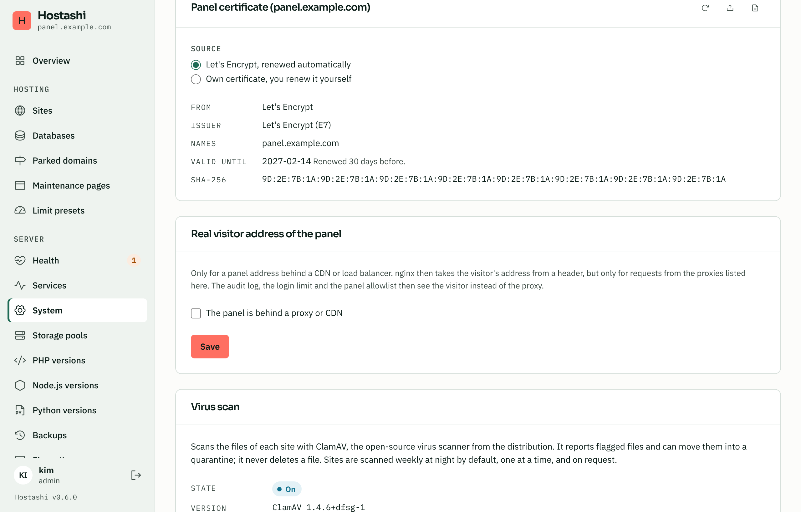
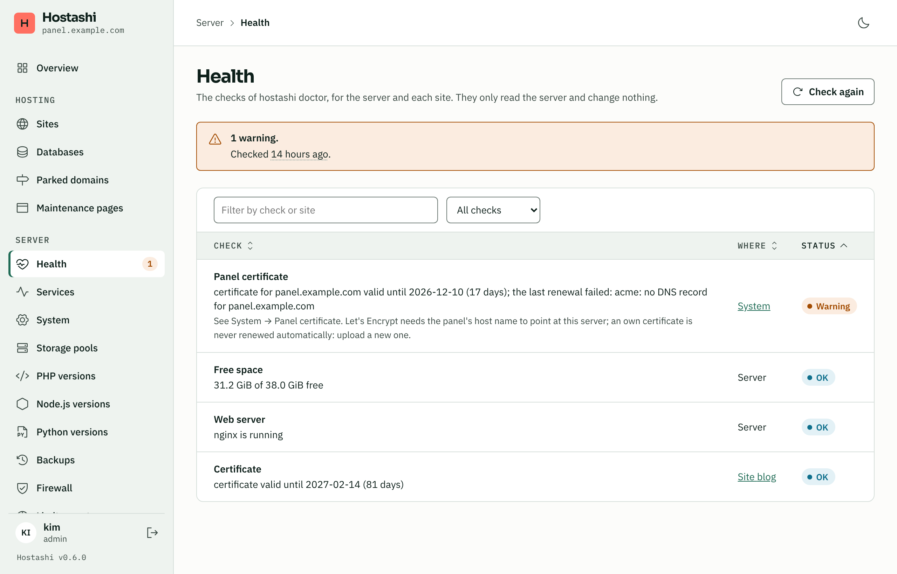

# System settings

Hostashi shows the server's hostname, time zone, clock and uptime, changes the hostname and the time zone, and reboots the server ([ADR-0060](https://github.com/maki-it/hostashi/blob/main/docs/adr/0060-time-zone-hostname-and-reboot.md)). The page also holds the panel's own certificate and its real visitor address.

**For:** admins. Managers and users do not see the page.

Open **System** in the Server part of the menu.

## Server

The first card shows the hostname, the time zone, the server's clock and whether it is synchronized, and the uptime. **Reboot needed** appears when installed updates wait for a reboot, with the packages that asked for it. The server never reboots by itself.

## Hostname

Use lowercase letters, digits and hyphens. A full name such as `web2.example.org` works too, up to 64 characters. The panel's address and the sites do not change.

Hostashi sets the name through systemd and also:

- points the `127.0.1.1` line in `/etc/hosts` to the new name, so `sudo` and local lookups keep working;
- writes `/etc/cloud/cloud.cfg.d/90-hostashi-hostname.cfg` if cloud-init is installed, so it does not set the cloud's server name again at the next boot.

## Time zone

Type to search the list of zones the server knows. Before you save, the hint shows what the server's clock would read.

- The sites' cron jobs follow the new time zone at once.
- MariaDB uses it after its next restart (**Services**, MariaDB, restart).
- PHP keeps its own `date.timezone` (see [PHP settings](PHP-settings.md)).

## Updates

Shown on servers set up from the `hostashi` package. The card shows the installed Hostashi version and the newest one apt saw in the Hostashi repository (apt fetches the list once a day). The versions link to their release notes.

**Node.js and Python patches** shows the package `hostashi-runtimes`: newer patch releases of the pinned Node.js and Python lines, published as signed data in the suite `runtimes` of the Hostashi repository and installed by unattended-upgrades every day, independent of the switch below ([ADR-0077](https://github.com/maki-it/hostashi/blob/main/docs/adr/0077-automatic-security-updates-for-pinned-runtimes.md)). The agent then installs the new release with its checksum check. **Not set up** means the installer has not run since the package came; the Health page says so too.

The switch **Automatic updates** applies at once and is recorded in the audit log:

- **On**: unattended-upgrades installs new Hostashi versions together with the daily security updates. Each update keeps a copy of the panel database first. Hostashi writes `/etc/apt/apt.conf.d/53hostashi-auto-update` for it, the same file as the installer option `--auto-update`.
- **Off**: new versions wait for `sudo apt upgrade`. The **Health** page and an email say when one is out.

A later run of the installer without `--auto-update` leaves the switch as it is.

## Panel certificate

Shown when the panel has its own host name (see [Install](Install.md)). It works like a site's certificate (see [Domains and HTTPS](Domains-and-HTTPS.md)): Let's Encrypt renews it by itself, or you upload an own certificate or create a CSR. The panel's certificate cannot be deleted.

The **Health** page warns about the certificate as **Panel certificate**: 21 days before it expires, as a failure 7 days before, and when getting or renewing it failed. The row links back to this page. Admins also get an email (see [Email notifications](Email-notifications.md)).

## Real visitor address of the panel

Only for a panel address behind a CDN or load balancer. See [Real visitor address](Real-visitor-address.md).

## Reboot

**Reboot server…** asks you to type the hostname. Every site, the databases and the panel stop until the server is back, usually within one or two minutes. The page waits and reconnects by itself. If the panel does not answer for ten minutes, check the server in your hosting provider's console.

## Audit log

Each change is in the [audit log](Audit-log.md): `system.hostname` and `system.timezone` with the old and the new value, `system.reboot` with the hostname and whether updates waited for it.

## API and command line

| Route | Scope |
|-------|-------|
| `GET /api/v1/system`, `GET /api/v1/system/timezones` | `system:read` |
| `PUT /api/v1/system/hostname`, `PUT /api/v1/system/timezone` | `system:write` |
| `POST /api/v1/system/reboot` with `{"confirm": "<hostname>"}` | `system:write` |

On the server, as root: `hostashi system info`, `hostashi system timezones`, `hostashi system timezone ZONE`, `hostashi system hostname NAME` and `hostashi system reboot HOSTNAME` (see [Command line](Command-line.md)).

## Requirements

The agent talks to systemd-timedated, systemd-hostnamed and systemd-logind over the system bus. The installer adds the `dbus` and `tzdata` packages. Without a running bus the page says so and changes nothing.
