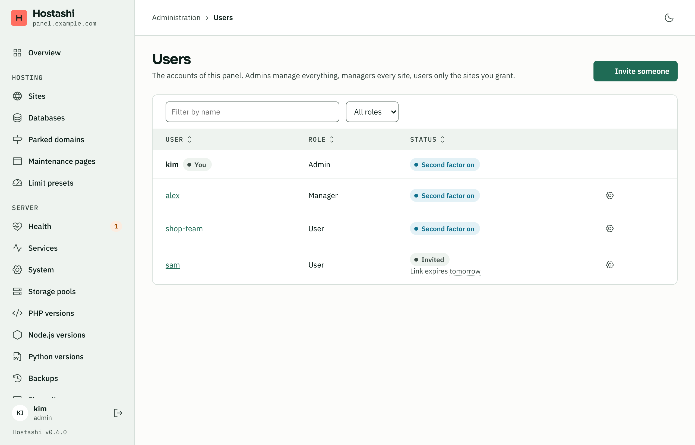

# Users and roles

**For:** panel admins.

## Roles

| Role | Sees | May |
|------|------|-----|
| `admin` | everything | everything, including users, server settings and other admins |
| `manager` | all sites | everything about sites, including creating and deleting them; no server settings and no users |
| `user` | only the sites given to them | the day-to-day work on those sites, see below |

Server settings are only for admins: users, firewall, backups, PHP and Node.js versions, email, system settings, the CloudPanel import and the health checks.

### What a user may do on their sites

| Allowed | Not allowed |
|---------|-------------|
| files, SSH and SFTP keys, cron jobs | domains and certificates |
| PHP version and settings | changing limits (they can see them) |
| maintenance mode, HSTS | letting PHP start programs |
| databases of the site, including import and export | own nginx directives |
| restoring a backup of the site | disabling or deleting the site |

A manager may do the "not allowed" column as well, except own nginx directives, which stay with admins.

A site that is not given to a user is invisible to them: it is not listed, and its address answers as if it did not exist.

## Invite someone

1. Open **Administration → Users** and choose **Invite someone**.
2. Enter a user name (3 to 32 characters: lowercase letters, digits, dot, dash and underscore) and the role.
3. Optionally an email address: the link is sent there if [email is set up](Email-notifications.md), and the address becomes the account's once the link is used.
4. Copy the **invitation link** and send it. It works once, within 24 hours. The new person sets their own password and, for admins and managers, a second factor.

For the role `user`, choose which sites the account gets on the account's page. You can change that at any time.

## Second factor

Admins and managers always need a second factor (authenticator app or passkey). For users it is optional; you can require it per account under **Sign-in**.

## Your own password, authenticator app and passkeys

Under **Your account → Sign-in and security** every account manages its own login:

- **Password:** enter the current one and the new one twice. Your other sessions are logged out; the browser you are in stays logged in.
- **Authenticator app (TOTP):** set it up, or turn it off with your password and a current code or recovery code. To move to another phone, turn it off and set it up again. Admins and managers must keep a second factor, so add a passkey first.
- **Passkeys:** add one with a name (for example the device), or remove one. A passkey counts as a second factor.

If an email address is set, Hostashi sends a note for each of these changes.

## When someone is locked out

On the account's page, **Reset password and second factor** removes both, ends the account's sessions and makes a new invitation link. If you are the last admin and locked out yourself, see [Recovery](Recovery.md).

## Disable or delete an account

**Disable** ends the account's sessions and stops its API tokens until you enable it again. **Delete** removes the account and its API tokens for good. The last enabled admin cannot be disabled or deleted, and nobody can change their own role.

Every change to accounts is in the [audit log](Audit-log.md).
