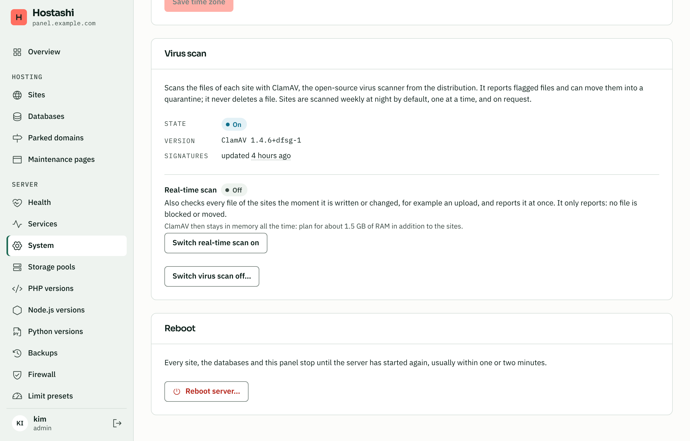
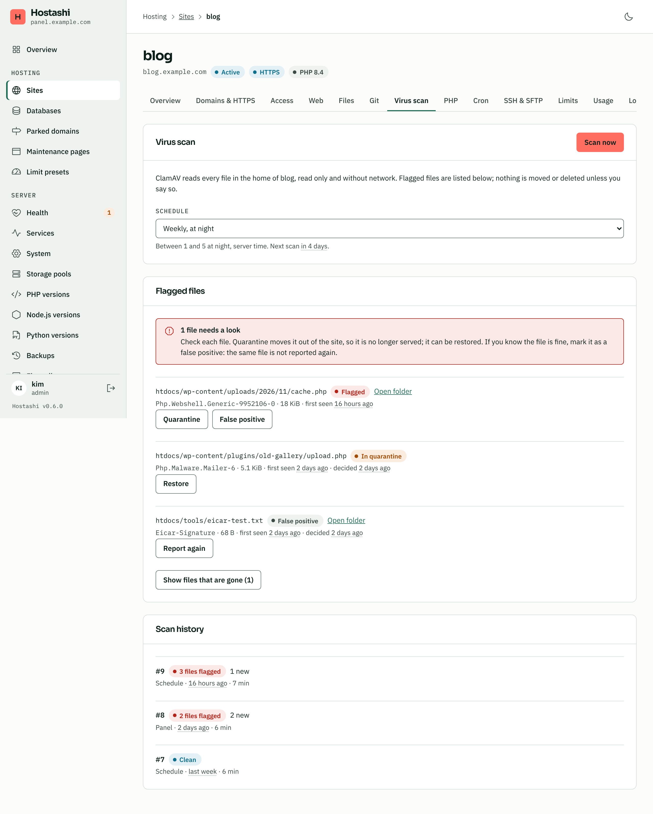
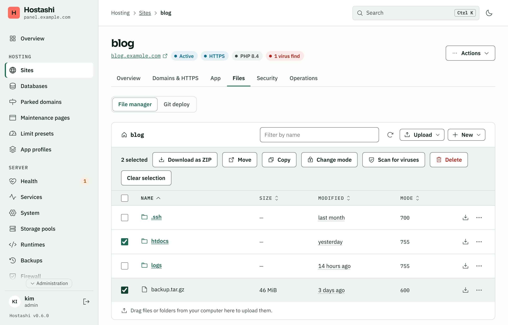

# Virus scan

The virus scan checks the files of your sites with [ClamAV](https://www.clamav.net/), the open-source scanner from the server's distribution. It finds known malware such as web shells, mailers and infected uploads, lists the files it flagged and lets you move them into a quarantine. It never deletes a file.

A clean result does not mean a clean site: ClamAV finds known samples only. Keep the sites' software up to date and the [firewall](Firewall.md) on.

**For:** admins switch the scan on for the server. Everybody who can open a site, users too, can scan it and quarantine flagged files. Admins and managers of the site change its schedule, mark false positives and restore files from the quarantine.

## Switch it on

The scan is off on a new server. An admin switches it on under **System → Virus scan**. Hostashi then installs ClamAV and its signature updater from the distribution; that takes a minute or two.



ClamAV needs memory while it scans: plan for about 1.5 GB of free RAM while a site is scanned. The card shows the server's memory and warns below 2 GB. Only one site is scanned at a time on the whole server, so this is paid once, not per site, and it does not count against a site's [memory limit](Limits.md). The signatures take about 300 MB on disk and are updated several times a day. ClamAV itself is updated once a day from the distribution: Hostashi updates only the ClamAV packages, also with versions the distribution ships outside its security updates. The card shows the installed version.

**Turn off…** next to the state removes ClamAV and its signatures again. Findings, the history and the quarantine stay.

You can also install it with the server: `install.sh apply --malware-scan` (see [Install](Install.md)).

## Real-time scan

With the virus scan on, an admin can also switch on the **Real-time scan** under **System → Virus scan**. ClamAV then watches the sites' homes and checks every file right after it is written or changed, for example an upload through a form, SFTP or the [file manager](File-manager.md).

The real-time scan only reports. It does not block, move or delete a file: flagged files show up in the site's **Security › Virus scan** tab as **Real time, today**, and you quarantine them as usual. Admins get at most one email per site and hour.

It keeps the ClamAV daemon running all the time, so it needs about 1.5 GB of RAM permanently, not only during a scan. Switch it on only on servers with enough memory; the card warns below 4 GB. While it is on, scheduled and manual scans use the daemon too.

**Switch real-time scan off** stops the daemon and removes its package. Findings stay.

## Scan a site

Open the site's **Security › Virus scan** tab.



- **Scan now** scans the site at once, or after the site that is being scanned now.
- While a scan runs, a bar shows how many files it has read of the files in the site. The server lists the files first ("finding the total"); large files take longer, so the bar can pause.
- **Schedule**: weekly (the default), every night, or only on request. Scheduled scans run between 1 and 5 at night, server time, each site at its own fixed time.

ClamAV reads every file in the site's home, read only and without network, as the site's own user. The folder `.cache` is skipped. Site databases are not scanned.

### Scan some files or folders

In the [file manager](File-manager.md), select up to 100 files and folders and click **Scan for viruses**. The button is there while the virus scan is on. The scan waits like any other, and its results appear on the **Virus scan** tab; the history lists the selected paths.



A scan of a selection marks only flagged files inside the selection as gone when they are not there any more. Flagged files elsewhere in the site stay as they are.

## Flagged files

Each flagged file shows its path, the name of the signature that matched, its size and when it was first seen. **Open folder** opens its folder in the [file manager](File-manager.md).

| Action | What it does |
|---|---|
| **Quarantine** | Moves the file out of the site, after you confirm. Visitors and the site get a 404 for it. Only a file that is unchanged since the scan is moved. |
| **False positive** | Marks the file as harmless. The same content with the same signature is not reported again, at any path. A changed file is reported again. |
| **Restore** | Puts a quarantined file back where it was, owned by the site's user. It fails if another file is at that path now. |
| **Report again** | Undoes **False positive**. |

A flagged file that is not there in a later scan is listed as gone; **Show files that are gone** shows those too.

When a scan flags files it had not reported before, admins get an email (see [Email notifications](Email-notifications.md)).

The **Health** page lists each site with open findings, and warns when the signatures are older than three days: then freshclam can no longer update them.

## Command line and API

Everything on this page is in the API and the [command line](Command-line.md):

```sh
hostashi api malware get-scan
hostashi api malware set-scan on=true
hostashi api malware set-scan realtime=true
hostashi api malware start-site-scan blog
hostashi api malware start-site-scan blog paths=htdocs/wp-content/uploads
hostashi api malware get-site-scan blog
hostashi api malware quarantine-site-finding blog 21
```

Tokens need the scope `malware:read` to read, `malware:write` to scan and act on findings, and `malware.engine:write` to switch ClamAV on or off.
