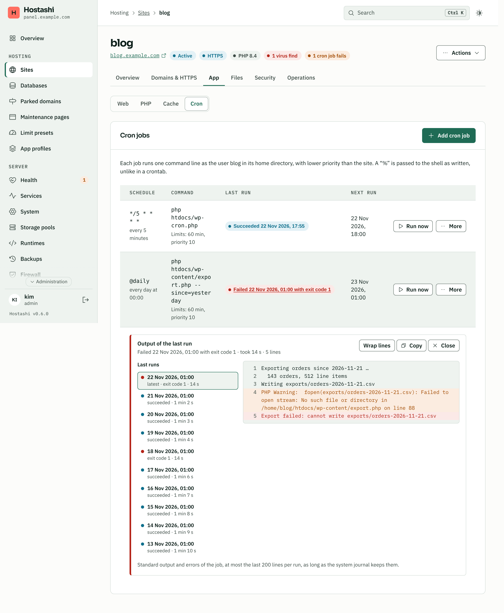

# Cron jobs

**For:** everybody who can open a site, including users.

A cron job runs a command on a schedule, as the site's Linux user, inside the site's limits. Open the site's **App › Cron** tab.

## Add a cron job

| Field | Meaning |
|-------|---------|
| **Schedule** | five cron fields (minute, hour, day of month, month, day of week), for example `*/15 * * * *` for every 15 minutes, or `@hourly`, `@daily`, `@weekly`, `@monthly` |
| **Command** | one line, run by the shell in the site's home, for example `php htdocs/wp-cron.php` |
| **Time limit in minutes** | the job is stopped when it runs longer |
| **Priority (nice)** | 0 to 19; higher numbers leave more CPU to the site itself |

The list shows the last and the next run of each job and how the last run ended.

## See the output of a run

Click the result under **Last run**, or choose **More → Show output**. You see what the command wrote to standard output and standard error in its last run: at most the last 200 lines, as long as the server's system journal keeps them. **Copy** copies the text. Everybody who can see the site's cron jobs can see their output, so do not let a job print passwords.

Beside the output, **Last runs** lists up to the last 10 runs with their start, result and duration. Click one to see what that run wrote. How far back the list goes depends on how long the system journal keeps entries.

On the command line: `hostashi api cron list-job-runs SITE ID` lists the runs, and `hostashi api cron get-job-output SITE ID run=RUN` shows the output of one; without `run=` it is the last run.

## Run, pause and delete

- **Run now** starts a job right away; its result shows up under **Last run**.
- **More → Change** opens the job's form.
- **More → Pause** keeps the job but stops its schedule. It then runs only when started by hand.
- **More → Delete** removes it.

While a site is disabled, its cron jobs do not run.

## Tips

- Use the full path below the home or a path relative to it; the job starts in the home folder.
- For WordPress, turn off its built-in cron (`define('DISABLE_WP_CRON', true);`) and run `php htdocs/wp-cron.php` every 5 to 15 minutes instead.
