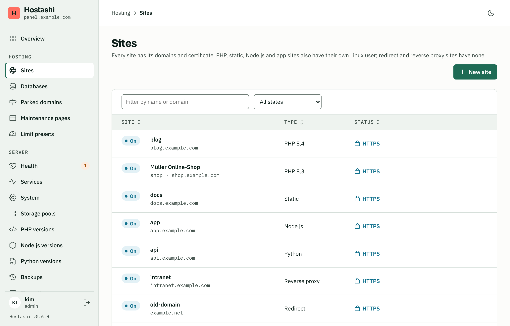
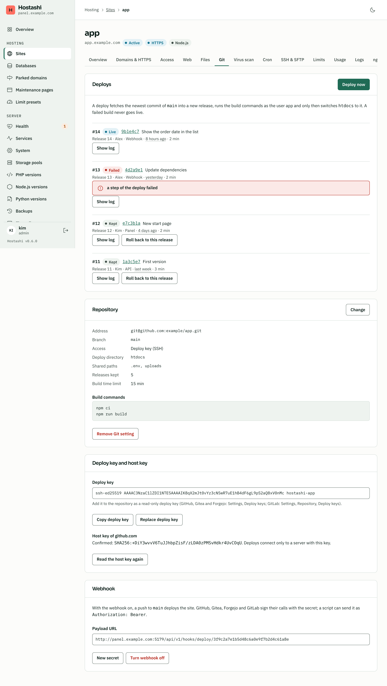
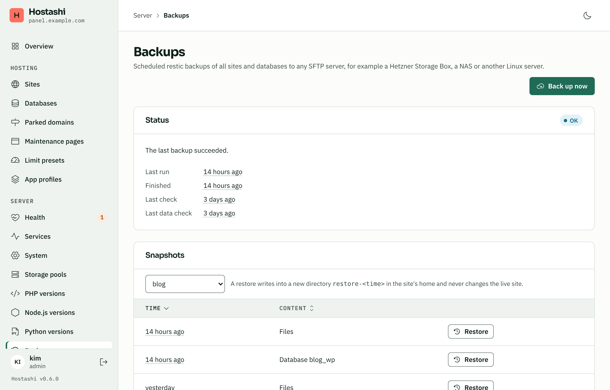
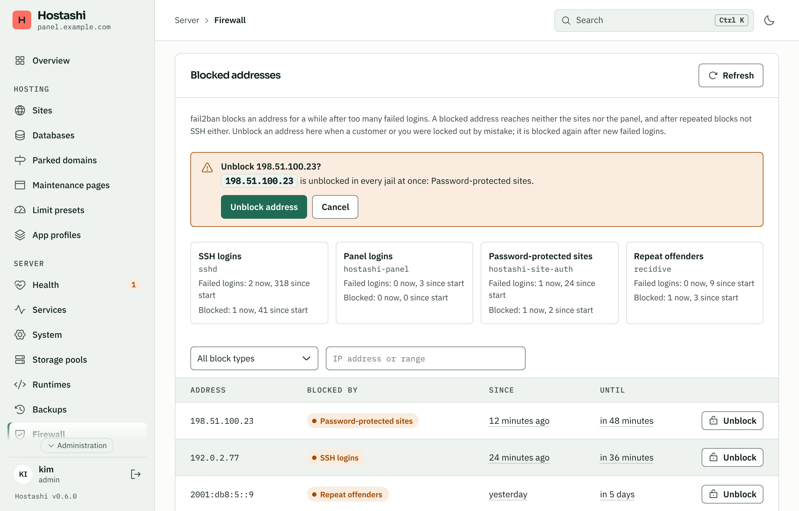

<!-- SPDX-License-Identifier: CC-BY-4.0 -->

<section class="hs-hero" markdown>

<div class="hs-hero__text" markdown>

<p class="hs-eyebrow">A product of <a href="https://maki-it.de/">Maki IT</a> · Open source · AGPL-3.0</p>

# Your server, your sites, one calm panel

Hostashi is a hosting control panel for a single Linux server. It runs PHP, Node.js, Python and static sites on nginx, with HTTPS, databases, backups and Git deploy, and it never needs root in the web process.

<div class="hs-install" markdown>

```sh
curl -fsSLO https://get.hostashi.com/install.sh
sudo bash install.sh --yes --panel-domain panel.example.com
```

</div>

<div class="hs-actions" markdown>
[Install guide](docs/Install.md){ .md-button .md-button--primary }
[Read the docs](docs/Home.md){ .md-button }
[Source on GitHub](https://github.com/maki-it/hostashi){ .md-button .hs-button--plain }
</div>

</div>

<figure class="hs-shot hs-shot--hero">
  
</figure>

</section>

<section class="hs-band" markdown>

## Everything a site needs, nothing it does not

<div class="hs-grid" markdown>

<div class="hs-card" markdown>
### Every kind of site
PHP in several versions side by side, Node.js, Python, static sites, reverse proxies, redirects and your own apps. WordPress in one step.
</div>

<div class="hs-card" markdown>
### HTTPS without thinking
Let's Encrypt for every domain, wildcard certificates through your DNS provider, or your own certificate. HSTS and security headers per site.
</div>

<div class="hs-card" markdown>
### Databases
MariaDB on the server, plus external MariaDB, MySQL and PostgreSQL servers. Size limits, import, export and a database tool in the browser.
</div>

<div class="hs-card" markdown>
### Backups you can restore
Encrypted restic backups of files and databases to any SFTP server, up to hourly. Restore from the panel; backups of deleted sites stay until you remove them.
</div>

<div class="hs-card" markdown>
### Git deploy and staging
Push to deploy with a webhook, build commands, atomic releases and rollback. Copy a site to staging and back.
</div>

<div class="hs-card" markdown>
### Locked down by default
Each site runs as its own Linux user with limits. Firewall, fail2ban, virus scan, passkeys and TOTP, roles and an audit log.
</div>

</div>

</section>

<section class="hs-feature" markdown>

<div class="hs-feature__text" markdown>

## Deploy from Git, roll back in a click

Connect a repository from GitHub, GitLab, Gitea, Forgejo or Bitbucket. Every deploy builds in a new release directory and goes live only when the build succeeds. The last releases stay, so going back is one click.

[How Git deploy works](docs/Git-deploy.md){ .hs-link }

</div>

<figure class="hs-shot">
  
</figure>

</section>

<section class="hs-feature hs-feature--flip" markdown>

<div class="hs-feature__text" markdown>

## Backups that run while you sleep

Choose a schedule and how many daily, weekly and monthly snapshots to keep. Restic encrypts every snapshot, and the panel warns you when a backup is overdue.

[Set up backups](docs/Backups.md){ .hs-link }

</div>

<figure class="hs-shot">
  
</figure>

</section>

<section class="hs-feature" markdown>

<div class="hs-feature__text" markdown>

## See who knocks, and let the right ones in

The firewall rolls back changes you do not confirm, so you cannot lock yourself out. fail2ban bans are listed in the panel, and you can lift one without a shell.

[Firewall and fail2ban](docs/Firewall.md){ .hs-link }

</div>

<figure class="hs-shot">
  
</figure>

</section>

<section class="hs-band hs-band--split" markdown>

<div markdown>

## Made for

- Agencies and freelancers who host their clients' sites on their own servers.
- Admins who want a panel they can read, audit and change.
- Anyone moving from CloudPanel: Hostashi scans the old server, copies sites and databases, and syncs once more before you switch DNS.

</div>

<div markdown>

## Not made for

- Mail or DNS servers: use a mail provider and your registrar's DNS.
- Billing, resellers or many servers from one panel.
- Servers that already host websites: Hostashi installs on a fresh one.

</div>

</section>

<section class="hs-cta" markdown>

## Try it on a fresh server

One script installs everything, and the panel greets you with a setup page.

<p class="hs-maker">Hostashi is built and maintained by <a href="https://maki-it.de/">Maki IT</a>, which uses it on its own servers.</p>

<div class="hs-actions" markdown>
[Install Hostashi](docs/Install.md){ .md-button .md-button--primary }
[Release notes](https://github.com/maki-it/hostashi/releases){ .md-button }
</div>

</section>
